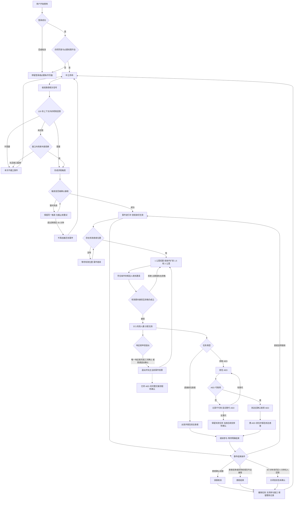
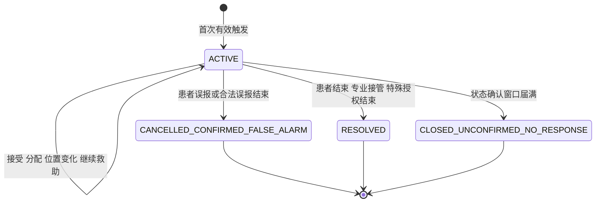
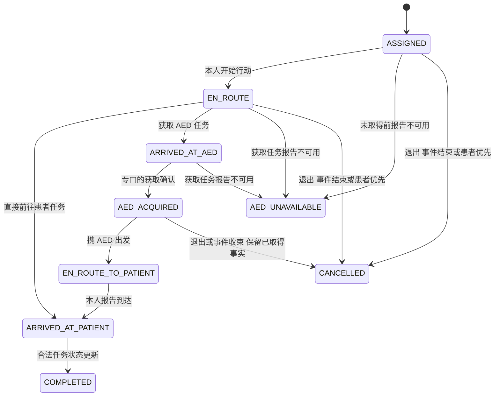
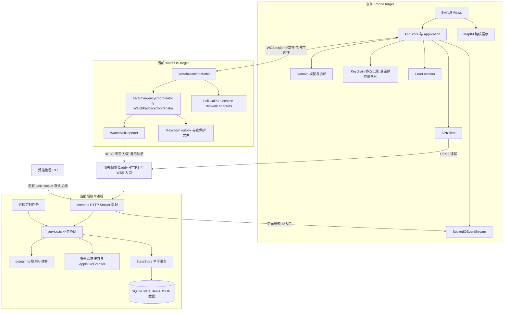
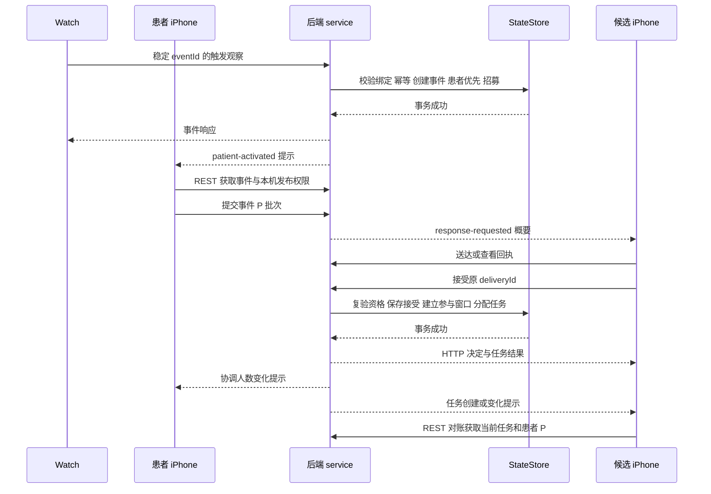

# AEDResponse 业务逻辑与架构设计评审稿

版本：2026-09-09 初稿，供设计评审，不代表批准实施或上线验收通过。

评审基线：桌面 `毕设项目` 的当前工作区，包含已有未提交修改。源码快照时间为北京时间 2026-09-09 01:13；Git HEAD 为 `8362af2`，但该提交不包含全部当前实现。文件指纹见同目录的 `AEDResponse评审源码基线-2026-09-09.json`。

本文严格分成两个部分。第一部分只说明业务行为、参与资格、状态及异常结果；第二部分说明这些行为在代码中的实现、数据权威、通信、模块边界和风险。第一部分的源码链接仅用于追溯，不承担技术实现说明。

证据标记的含义如下：

- **【代码已确认】**：可从快照中的条件判断、调用关系、数据结构或配置直接证明。它不等于真机、线上或并发压测已经通过。
- **【设计推断】**：根据代码结构推断的目的、影响或改进建议。建议均未执行，也不是新增业务规则。
- **【待确认】**：代码无法确定的业务选择、文档与代码不一致的规则、缺失流程，或需要外部验证的事实。本文不替评审者做决定。

阅读顺序：业务角色 → 全流程 → 分流程条件 → 状态机 → 异常与待确认事项 → 当前架构 → 数据所有权与通信 → 架构问题与风险清单。

## 一 详细业务逻辑

### 1 系统实际处理的业务

**【代码已确认】** 系统处理的是“跌倒相关求助事件中的附近志愿协同”：为求助者建立事件，寻找符合条件的附近人员，由受邀者自主接受，再分配“直接前往患者”或“先取 AED 再前往患者”的任务，记录人员操作、位置事实、AED 获取及事件结局。[B01][B02][B03]

**【代码已确认】** 系统没有普通用户手动创建 SOS 事件的正式入口；也没有由 App 自动拨打急救电话、按号码确认已经呼叫急救中心、根据通话结束自动判定救助完成的业务路径。测试事件具有独立标记，不属于真实跌倒的证明。[W01][U01][T01]

**【待确认】** 实际志愿者培训、急救资质、保险、AED 资产维护责任及与医疗机构的合作流程，当前代码没有形成完整业务模型。不能从“接受任务”推断参与者具备某项专业资格，也不能把“专业急救已接管”的用户报告当成外部机构已认证的事实。

### 2 业务角色与权限

**【代码已确认】** 以下主要是同一用户在不同阶段的身份，而不是注册时手动选择的永久角色。患者优先于响应者，响应者优先于中立待命。[U02]

| 角色或参与状态 | 能够做什么 | 什么时候可以做 | 不能做什么 | 依据 |
| --- | --- | --- | --- | --- |
| 【代码已确认】未登录用户 | 发起手机号或 Apple 登录 | 尚未建立有效身份 | 进入救助业务、接受任务、上报业务位置 | [U01][A01] |
| 【代码已确认】已登录但未完成门槛的用户 | 完成四项同意、申请必要权限、退出登录 | 身份有效，协议或权限不完整 | 使用正常待命和救助业务页面 | [U01][U03] |
| 【代码已确认】中立待命用户 | 查看附近可参与人数；接收响应请求 | 同意、权限、可用性和位置满足条件 | 自选患者身份、给自己或别人分配任务 | [B04][U04] |
| 【代码已确认】待决定候选人 | 查看本人的邀请概要；接受或拒绝 | 邀请仍有效，接受时资格仍成立 | 在接受前通过正常事件视图获取患者精确位置；操作他人的邀请 | [B02][B05] |
| 【代码已确认】患者 | 查看自己的救助状态、人数汇总；确认误报、结束救助；回答是否继续救助 | 本人关联的事件仍进行中 | 作为本事件响应者参与；用“误报”取消系统电话 | [B01][B06][U05] |
| 【代码已确认】已接受响应者 | 查看获授权患者位置和本人任务；开始行动、报告到达、报告 AED 获取或不可用、申请退出 | 已接受且对应任务、事件和权限仍有效 | 修改其他人的任务；随意切换任务角色；退出后重新加入同一事件 | [B02][B03][B07] |
| 【代码已确认】已到场响应者 | 报告专业急救已经接管 | 本人任务状态为已到患者或已完成，事件仍进行中 | 未到场时以到场响应者身份结束事件 | [B06][B08] |
| 【代码已确认】特殊授权操作方 | 通过受保护操作结束指定事件 | 持有专门的操作凭据并使用对应操作身份 | 将普通用户身份声明成授权操作方 | [B06][A02] |
| 【代码已确认】受控测试人员 | 在明确标识的测试身份和测试事件中走指定业务链路 | 测试能力明确开启且符合测试名单 | 把模拟事件当真实跌倒、把测试身份当真实手机号或 Apple 验证 | [T01][T02] |

**【代码已确认】** “任务完成”不等于“已退出事件”。已完成任务的响应者仍可能属于事件参与者；任务取消或超时才会在相应判断中结束任务参与，明确退出另有永久禁止重入的记录。[B09]

**【待确认 Q01】** 特殊授权操作方目前具备技术入口，但“由谁担任、可以因哪些原因结束事件、是否需要审批或双人复核”没有在当前业务代码中形成完整流程，不能将其等同于已实现的普通管理后台。

### 3 一次完整业务的发生 推进与结束

#### 3.1 正常流程叙述

1. **【代码已确认】准备与待命**：用户登录，分别完成患者协议、志愿响应者协议、隐私政策及敏感个人信息同意，再具备所需定位与通知权限，进入中立待命。已绑定的手表还需满足自己的授权条件。[U03][W02]
2. **【代码已确认】发现求助条件**：手表收到跌倒相关信号，建立短期上下文。用户在窗口内回答“需要帮助”可以触发；回答“不需要帮助”则取消本次待决上下文。未回答时，仅窗口内的新外拨观察可以触发。[W01]
3. **【代码已确认】事件成立**：首次有效触发建立“进行中、招募中”的事件。重复的同一触发不会创建第二个事件。患者身份自动生效；若该用户此前在其他事件中响应，患者优先处理会撤销其原有响应安排。[B01][B10]
4. **【代码已确认】等待有效位置并招募**：有合格患者位置后，系统从 1 公里开始筛选；人数潜力不足或等待后接受人数不足时，扩到 1.5 公里、再到 2 公里。没有合格位置时事件可已成立，但不能正常进行地理招募。[B11]
5. **【代码已确认】自主决定**：候选人收到 30 秒有效邀请。接受时再次检查资格。拒绝、过期或资格失效者不计入有效响应人数。[B02]
6. **【代码已确认】分配并行动**：系统按实际接受人数及 AED 可用资源分配任务；每个新接受者立即获得当前可执行的安排，不要求先凑满 3 人。响应者按任务开始行动，报告到达、AED 获取或不可用。[B03][B12]
7. **【代码已确认】处理变化**：患者位置更新、人员接受或退出、AED 不可用等会引起对应范围的协调更新。已经开始的任务受到保护，不能简单因人数变化全部重新安排。[B07][B12][B13]
8. **【代码已确认】结束**：患者确认误报、患者确认救助结束、到场响应者报告专业接管，或状态确认窗口届满无人回答，可以形成不同终态。无人响应、电话结束或网络断开本身不等于事件结束。[B06][B14]
9. **【代码已确认】收束**：结束后停止当前志愿任务、关闭参与时间窗口；手机恢复可用的待命状态。已产生的位置事实和业务记录不会因为界面返回待命而被当作未发生。[B06][B15][U06]

**【待确认】** 第 9 步在 Watch 端的结束接收与本地清理链路存在缺口，不能声称当前所有设备都已形成完整结束闭环。详见第二部分 R02。

#### 3.2 完整业务流程图

**【代码已确认】** 实线表示代码中可追踪的业务主路径；标有“待确认”的节点表示缺失或未定规则，不作为既有流程承诺。

### 4 关键业务流程的条件与结果

#### F01 登录 同意与启用

**【代码已确认】** 登录与业务启用分开；登录成功并不直接授予救助业务可用状态。[A01][U03]

| 项目 | 当前规则 |
| --- | --- |
| 谁可以发起 | 未登录用户，或需要恢复身份的用户 |
| 触发条件 | 用户选择手机号登录、Apple 登录，或启动后尝试恢复身份 |
| 前置条件 | 验证凭据有效；使用手机号时挑战未过期、未使用、未锁定且号码一致 |
| 执行动作 | 验证身份；关联稳定用户；完成四项同意；检查通知及“始终允许且精确”的手机定位权限 |
| 状态变化 | 未登录 → 已登录未就绪 → 已就绪待命；失败时不进入已就绪 |
| 后续结果 | 可以开展待命、位置和后续设备协同 |
| 不允许的情况 | 仅授予前台定位、关闭精确定位、拒绝必要同意或通知时，不能使用正常业务主界面 |

**【代码已确认】** 手机挑战有效期为 5 分钟；错误验证累计达到 5 次会锁定该挑战；已使用挑战不能再次成功消费。手机号和 Apple 身份按各自认证方式匹配，没有自动把两种登录合并成同一个人的业务流程。[A01]

**【待确认 Q02】** 真实短信服务及 Watch 设备证明的完整运行依赖尚不具备；代码中的正式入口不等于供应商已接通。两种登录是否需要账号合并，必须另定规则，不能按号码或用户声明自动推断同一身份。[A03]

#### F02 跌倒上下文与求助触发

**【代码已确认】** 下表描述的是手表已完成绑定且业务监控条件成立之后的行为。[W01][W02]

| 项目 | 当前规则 |
| --- | --- |
| 谁可以触发 | 已绑定用户的手表观察流程；普通手机用户没有等价的正式手动入口 |
| 触发条件 | 跌倒上下文内明确回答需要帮助；或没有回答且观察到窗口内的新外拨 |
| 前置条件 | 对应跌倒上下文存在；时间在跌倒之后且不超过 120 秒；同一事件没有已处理标记 |
| 执行动作 | 固定事件标识，记录帮助回答及必要观察信息，准备求助上报 |
| 状态变化 | 无待决上下文 → 待回答 → 取消、过期或形成触发 |
| 后续结果 | 成功确认接收后激活业务事件；失败则保留同一触发重试 |
| 不能触发 | 仅收到恢复、心率或电话结束信息；只有旧通话；没有跌倒上下文；超过窗口才作出的回答或外拨观察 |

**【代码已确认】** “需要帮助”分支不等待外拨；“不需要帮助”取消的是本次尚未成立的求助上下文。已经形成并被处理的触发，随后迟到的回答不会被当成撤销已成立事件的指令。[W01]

**【代码已确认】** 若外拨信息先到达、跌倒信息稍后到达，但两者的发生时间满足关联窗口，当前实现可以把先前的外拨与跌倒匹配。多个待决跌倒中，新外拨优先匹配时间较新的合格上下文。[W01]

**【待确认 Q03】** 同一用户在已有进行中事件时再次出现不同跌倒事件标识，当前创建流程没有明确的“一人仅一个活动患者事件”限制。新的标识可能建立另一事件。需要确认应拒绝、合并、关联为同一事件的新观察，还是允许并行；本文不选择其中一种。[B01]

#### F03 事件成立与患者优先

**【代码已确认】** 有效首次触发建立 `ACTIVE / RECRUITING`；同标识、同内容的重试返回既有事件，同标识但内容不同被拒绝。超过跌倒后 35 分钟的首次上报不能新建事件；已存在事件的合法重放与“首次迟到创建”是不同情况。[B01]

| 项目 | 当前规则 |
| --- | --- |
| 谁可以执行 | 原始绑定手表及其合法上报；受控测试另走独立流程 |
| 前置条件 | 绑定和主体一致、触发内容合法、首次创建没有超过截止时间 |
| 执行动作 | 建立事件、确认患者身份、保留触发快照、停止该用户冲突的响应身份 |
| 状态变化 | 中立或响应者 → 患者；事件从不存在变为进行中 |
| 后续结果 | 通知相关手机；有效位置具备后开始招募 |
| 不允许 | 其他手表重放或覆盖该事件；同一业务标识改写成另一份观察；患者继续作为附近候选人 |

**【代码已确认】** 同账号其他手机可以获得患者视图，但不因此自动成为该事件的位置发布设备。查看患者状态与发布患者位置是分开的权限。[B16]

#### F04 位置有效性与备用来源

**【代码已确认】** 业务上区分患者位置 P、响应者或待命位置 R、AED 位置 A。患者事件生效后，患者设备不能继续以待命 R 身份参与候选筛选。[B17]

| 使用场景 | 当前行为 | 不能做什么 | 依据 |
| --- | --- | --- | --- |
| 【代码已确认】普通待命 | 有新定位时，按 120 秒或移动 100 米的条件更新最新位置 | 不能把同一旧位置改成新采样时间 | [U07] |
| 【代码已确认】搜索范围内尚未接受 | 有新定位时，按 15 秒或移动 30 米条件更新 | 不能将提高更新频率理解为已经接受救助 | [U07] |
| 【代码已确认】患者或已接受响应者 | 在合法参与时间窗口内逐秒记录真实位置事实；通常五个连续秒槽一批，移动达到 10 米可提前提交 | 不能用上一秒坐标伪造每秒都有新定位；不能修改首次提交后已经封口的事实 | [B18][U08] |
| 【代码已确认】患者手机来源暂不可用 | 手表在满足备用条件时提供位置；连续 10 秒没有有效手机 P 后，才允许备用来源成为有效位置 | 不能仅凭手机与手表无法即时通信就判定手机没有互联网 | [B19][W03] |

**【代码已确认】** 手机 P 是优先来源。手表启动备份需要同时满足：已有本地活动事件、手机不处于“已激活且即时可达”、手表观察到网络可用。首次合格样本可立即发送，后续按 5 秒或移动 10 米安排。符合条件的手机 P 恢复后重新取得主来源；较旧或同时间的手表样本不能覆盖较新的手机位置。[W03][B19]

**【代码已确认】** 手机位置和手表备用位置的新鲜度依据上报的观察时间判断，设备最近联系时间不是位置采样时间。坐标、精度、时间越界时拒绝或判为不能应用；同时间内容不同也可能构成冲突。候选范围、精度和时效边界按当前配置判断，不由用户自行放宽。[B17]

**【代码已确认】** 配置中的开发默认值为：位置最大年龄 600 秒、最大精度误差 200 米、允许的客户端未来时钟偏差 120 秒。这是默认值，不是对当前位置精度或实际部署配置的证明。生产模式要求相关配置显式提供；边界之外的位置不能据此用于有效匹配。[A06]

**【待确认 Q15】** 手表触发时的初始快照没有保留独立的实际定位时间，当前用跌倒或外拨观察时间作为其时间依据。这不能证明该坐标当时刚刚采集。应允许多旧的初始定位、没有合格快照时如何等待定位，需要确认；风险见第二部分 R16。[W06][B01]

**【代码已确认】** 某秒没有新定位，保留“没有新位置”的事实及原因；恢复时区分此前运行但无定位与程序未运行的缺口。已有合法记录的迟到补传，不等于允许退出后继续采集新位置。[B18][U08]

**【待确认 Q04】** “完整参与时段每秒恰好一条记录”的最终完成判据尚未闭合：代码会验证已收到的批次，但没有显式的整段上传完成协议。不能把暂时未到的批次当永久缺失，也不能把已收记录无重复等同于整段无缺口。

#### F05 附近人数展示

**【代码已确认】** 只有符合条件的中立待命用户可以查看附近人数。以自己的合格位置为中心，给出 1、1.5、2 公里内的累计人数，排除本人所有设备、活动患者和已参与救助者，并按稳定用户去重。三个圈是累计数，不能相加。[B04][U04]

**【代码已确认】** 展示可以切换列表和范围地图，但没有被统计者的个人点位；结果过期、缺位置或请求失败显示不可用，不把未知显示为 0。只有成功返回的 0 才表示本次统计为零。展示缓存有效期为 120 秒。[U04]

#### F06 招募与接受

**【代码已确认】** 目标接受人数为 3，但当前代码没有将 3 作为硬性人数上限。它会向合格候选人生成邀请，并按实际有效人数分配；不能在评审中把“目标 3 人”写成“最多 3 人”。[B11][B02]

| 项目 | 当前规则 |
| --- | --- |
| 谁能被邀请 | 有稳定身份和合格设备，四项协议有效，通知定位能力可用，当前可用，位置有效，在当前范围内且没有身份或任务冲突的用户 |
| 触发条件 | 事件招募中且有有效患者位置；资格、位置、时间阶段等变化可重新评估 |
| 执行动作 | 初始 1 公里；潜在人数不足时继续扩圈；接受不足并超出阶段等待时间时扩圈；最多到 2 公里 |
| 状态变化 | 用户仍为候选，邀请从不存在变为待决定；只有接受成功才成为有效响应者 |
| 后续结果 | 接受者计入 N 并触发分配；拒绝、超时、资格失效不计入 |
| 禁止情况 | 患者本人、已退出同事件者、其他事件中忙碌者、过期位置、能力不足或越界者不能接受成功 |

**【代码已确认】** 接受时重新检查资格，不能只依赖发出邀请时的资格。邀请在到达有效期边界时失效；迟到的接受不能复活过期邀请。多个设备属于同一用户时，不能重复计为两名响应者。[B02][B09][B11]

**【代码已确认】** 当前手机还有一项前置条件：必须先记录“已查看”，并等待系统确认该查看记录后才能接受或拒绝。仅仅看到了页面还不够，确认未到时会要求稍后重试。[U14]

**【待确认 Q16】** 处理邀请决定的业务方法本身没有同样强制要求“已查看确认完成”。因此手机与决定处理规则并不完全一致；“已查看确认”是必须的业务门槛，还是仅用于统计的记录，需要明确，不能自行假定其中一方正确。[B02][U14]

**【代码已确认】** 同一事件中，已产生过邀请的用户不会因换设备、拒绝或过期而自动再获得新邀请。既有拒绝或过期决定保持终态。扩圈不缩小；扩圈逻辑检查现有接受人数和仍可能接受的人数。[B11]

**【待确认 Q05】** 是否将“拒绝或过期后本事件不再邀请”和“目标 3 人但允许超出”作为明确业务规则，需要评审确认。当前代码采取上述行为，本文不把它推导为已经获得产品批准。

#### F07 分配任务与执行

**【代码已确认】** 有效人数 N 只计算仍参与事件的已接受用户。资源充足时，AED 任务数为普通四舍五入后的 `N / 3`，其余前往患者；不是按第一、第二、第三个接受者固定分工。[B09][B12]

| 有效人数 N | 直接前往患者 | 获取 AED |
| --- | --- | --- |
| 1 | 1 | 0 |
| 2 | 1 | 1 |
| 3 | 2 | 1 |
| 4 | 3 | 1 |
| 5 | 3 | 2 |

**【代码已确认】** 表中数量以资源充足、没有超额锁定任务为前提。AED 不足时使用现有资源，其余可调整人员前往患者；不因为 AED 不足拒绝一次原本有效的接受。已开始或已取得 AED 的任务受到保护，即使人数下降后数量超过新公式也不会简单撤换。[B12]

| 流程 | 触发与前置条件 | 用户动作 | 状态变化与结果 |
| --- | --- | --- | --- |
| 【代码已确认】直接前往患者 | 接受成功并获此任务；事件进行中 | 开始前往 → 报告到达 | 已分配 → 在途 → 到达患者；仍属事件参与者 |
| 【代码已确认】取得 AED | 本人的获取任务有效，AED 与任务一致 | 开始前往 → 报告到达 AED → 确认取得 | 已分配 → 在途 → 到达 AED → 已取得 |
| 【代码已确认】携 AED 前往 | 已确认取得 AED | 确认携 AED 前往 → 报告到达患者 | 已取得 → 携带在途 → 到达患者 |
| 【代码已确认】报告专业接管 | 已到患者或任务已完成；事件未结束 | 报告急救接管 | 事件进入救助结束，原因保留为专业接管 |

**【代码已确认】** “到达”由响应者操作报告，当前任务推进检查的是本人权限和允许的状态转换；没有以实际地理围栏或外部急救人员确认作为所有到场操作的强制证据。因此“系统记录已到达”与“现实中确实到达”不能混同。[B03][B08][U09]

**【待确认 Q06】** 当前参考分配使用估计用时选择人员与 AED，没有完成目标文档中的真实步行绕行不超过 300 秒和在途改道 15 秒明确确认流程。这些不能放入当前已实现业务规则；是否继续按目标规则实现及完整交互需确认。[B12][B20][D01]

#### F08 AED 不可用与交接

**【代码已确认】** 仅本人有效获取任务可以报告对应 AED 不可用。已经确认取得的 AED 不能再按“未取得且不可用”处理；同一报告的合法重复不会重复建立新的业务事实。[B13]

| 项目 | 当前行为 |
| --- | --- |
| 触发条件 | 获取任务持有人报告设备未找到或不可使用 |
| 前置条件 | 任务与 AED 匹配；事件进行中；任务未终止且尚未确认取得 |
| 执行动作 | 保留不可用报告；把原任务置为 AED 不可用；尝试给原响应者寻找替代 AED |
| 状态变化 | 原任务成为失败尝试的终态；找到替代时创建新任务，原任务不改写成新 AED 任务 |
| 后续结果 | 响应者仍可属于事件参与者；有替代时执行新安排 |
| 不能做 | 把已获取的 AED 再分配为同事件的另一次获取；通过改写原报告掩盖失败事实 |

**【待确认 Q07】** 本次不可用处理找不到替代 AED 时，当前方法不会立即生成“前往患者”的替代任务，界面显示等待安排。后续其他触发的重算可能补任务，但当前不是无条件立即降级。应立即前往患者、继续等待还是另发决策，需要确认。[B13][U09]

**【待确认 Q08】** 已持 AED 的响应者退出后，代码保留该 AED 已获取事实并记录交接未完成，没有完整当面双确认或拍照放置、生成临时 AED、后续寻找确认的闭环。退出后的权限已撤销，交接究竟必须在退出前完成，还是保留特定交接权限，需要明确；不能自行新增例外权限。[B07]

**【待确认 Q09】** 同一台 AED 在两个不同事件之间是否必须互斥、何时释放、由谁确认恢复可用，当前没有完整业务规则。当前排重主要按事件执行，不能声称已解决跨事件争用。[B12][B21]

#### F09 主动退出

**【代码已确认】** 主动退出针对已接受响应者；患者结束救助、候选人拒绝邀请、响应者退出是三个不同操作。[B07][U10]

| 项目 | 当前规则 |
| --- | --- |
| 谁可以 | 本事件仍进行中的已接受响应者；患者和未接受候选人不适用 |
| 触发条件 | 用户选择退出响应 |
| 前置条件 | 对应参与关系存在；唯一响应者完成三步连续确认；任一步取消不退出 |
| 执行动作 | 提交退出决定；成功后撤销该事件精确位置、任务和通信权限，关闭参与窗口 |
| 状态变化 | 参与中 → 已退出；该用户不得重新加入同一事件 |
| 后续结果 | 人数低于目标时重新招募；剩余人员按规则补位；N 为 0 时事件继续 |
| 失败或取消 | 未确认完成或提交失败不能声称已退出；保留重试或重新确认机会 |

**【代码已确认】** 点击退出入口不计作三次确认中的一次。唯一响应者判定也会在处理退出时复核；用户界面旧人数并不能绕过该检查。系统会记录用户已经完成确认的声明，但不能仅凭该声明证明现实中确实发生了三次点击。[B07][U10]

#### F10 误报 救助结束与定时确认

| 结束方式 | 谁可以发起 | 前置条件 | 结果 | 分类 |
| --- | --- | --- | --- | --- |
| 误报 | 关联患者 | 事件进行中；手机页面单独确认 | `CANCELLED_CONFIRMED_FALSE_ALARM`；不能计为救助成功 | 【代码已确认】 |
| 患者结束救助 | 关联患者 | 事件进行中；手机页面单独确认 | `RESOLVED`，原因 `PROBLEM_RESOLVED` | 【代码已确认】 |
| 专业接管 | 到场响应者 | 对应任务到达患者或已完成；事件进行中 | `RESOLVED`，原因 `PROFESSIONAL_TAKEOVER` | 【代码已确认】 |
| 特殊授权结束 | 特殊授权操作方 | 专门凭据与操作身份匹配 | 按请求合法原因进入对应终态 | 【代码已确认】 |
| 状态未确认关闭 | 系统状态确认流程 | 30 分钟时需确认；5 分钟内没有有效继续回答 | `CLOSED_UNCONFIRMED_NO_RESPONSE`，不能计为已解决 | 【代码已确认】 |

依据：[B06][B08][B14][U05][U09]。

**【代码已确认】** 患者选择继续后重新开始 30 分钟周期。如果服务在整个确认窗口内没有运行，恢复检查时可以直接记录“未确认关闭”，不证明患者曾实际收到询问。[B14]

**【代码已确认】** 已完成任务、无人响应、程序关闭、网络断开、手表恢复或电话结束，不能单独当成事件成功终结。结束后对已在合法窗口内产生的位置进行补传，是保留既有事实，不是继续创建结束后的患者轨迹。[B06][B15]

**【待确认 Q10】** 用户未真正收到状态询问时是否仍按原始截止时间关闭，是当前代码已经采取、但需要明确评审接受的业务行为。到场接管按钮目前直接提交；它是否满足产品要求的“一次明确确认”也需明确，不能推测还存在第二个确认页面。[B14][U09]

### 5 核心业务状态机

#### 5.1 事件状态

**【代码已确认】** 下图只包含实际存在的事件状态；“本地待回答”属于触发过程，不是服务端事件状态。[B06][B14][B22]

**【代码已确认】** 当前没有终态返回 `ACTIVE` 的普通业务转换。终态后再次提交一个新的冲突结束请求会被拒绝；持有已保存幂等结果的同一请求可以在相应接口返回既有结果。

#### 5.2 招募状态与事件状态的关系

| 状态 | 含义 | 主要允许转换 | 分类 |
| --- | --- | --- | --- |
| `RECRUITING` | 允许产生与处理合格邀请 | 全部当前任务完成后可到 `COMPLETED`；事件取消或未确认关闭后到 `STOPPED` | 【代码已确认】 |
| `COMPLETED` | 招募阶段已完成，或随救助结束收束 | 事件仍活动且明确退出造成有效人数低于目标时，可重新到 `RECRUITING` | 【代码已确认】 |
| `STOPPED` | 当前不再招募 | 普通终态路径不自动恢复 | 【代码已确认】 |

**【代码已确认】** 事件可以仍为 `ACTIVE`，而招募已经 `COMPLETED`。两者不是同一个状态，不能用“任务都完成”替代“救助事件已经结束”。[B03][B07][B12]

#### 5.3 邀请状态

**【代码已确认】** 正常送达回执推进为 `SENT → DELIVERED → VIEWED`。收到、看过都不等于接受。有效待决阶段可以由独立决定转为 `ACCEPTED` 或 `REFUSED`；到期、失去资格或事件结束则可能转为 `EXPIRED`。[B02][B05]

**【代码已确认】** 完全相同的既有决定不反复产生副作用；不同决定不能覆盖既有决定。晚到的低阶段回执不能把已接受、拒绝或过期状态倒退为送达或查看。

#### 5.4 任务状态

**【代码已确认】** 此图用代表性边展示特殊取消操作；取消可以作用于其他尚未终止的任务阶段。`AED_UNAVAILABLE` 的原任务保持终态，替代任务使用新标识；`COMPLETED` 不自动等于退出事件。[B03][B07][B12][B13]

**【代码已确认】** 模型和客户端还识别 `TIMED_OUT`，但这只是“状态类型存在”的证据。[B22][U06]

**【待确认 Q11】** 尚未找到正式流程按“15 秒通信不确定、30 秒通信失联”产生任务超时并补位的完整执行路径。不得把模型中存在 `TIMED_OUT` 写成已经实现自动失联判断。

#### 5.5 位置来源与用户身份状态

| 状态组 | 允许的变化 | 不应混同 | 分类 |
| --- | --- | --- | --- |
| 用户运行身份 | 中立 → 响应者；中立或响应者 → 患者；结束或退出后回到合适的待命状态 | 响应请求弹出不是已接受 | 【代码已确认】 |
| 患者位置来源 | 触发快照 → 手机主来源；满足静默及样本条件后手机主来源 → 手表备用；有效手机 P 恢复 → 手机主来源 | 切位置来源不创建或结束事件 | 【代码已确认】 |
| 参与关系 | 接受 → 参与；明确退出 → 永久退出该事件；事件结束 → 参与窗口关闭 | 合法历史补传不恢复当前参与权 | 【代码已确认】 |

### 6 异常与边界处理

| 情况 | 当前业务结果 | 不可据此认定的事实 | 分类与依据 |
| --- | --- | --- | --- |
| 触发上报时断网 | 保留同一触发，在规定截止前重试 | 未确认接收时不能说事件已在服务中创建 | 【代码已确认】[W01] |
| 手机业务连接中断 | 暂停网络提交并尝试恢复；已有事件的合法本地位置事实继续排队 | 断网不等于事件结束 | 【代码已确认】[U06][U08] |
| 手表与手机不可即时通信，但手表有网络 | 可按条件提交备份，由实际手机 P 到达情况决定采用 | 不能证明手机本身没有网络 | 【代码已确认】[W03][B19] |
| 手表与手机不可即时通信，手表也无网络 | 正常待命状态可提示不可用；活动事件不因此结束 | 不能保证此时求助一定可被外界收到 | 【代码已确认】[W02] |
| 同一请求重试 | 相应稳定标识和内容相符时可返回既有结果；内容冲突时拒绝 | 不是所有按钮和接口都采用完全相同重试机制 | 【代码已确认】[B02][B07][B21] |
| 同时接受 | 每个决定处理时重新检查最新资格并更新人数和任务 | 不能先在各用户界面独立决定分工 | 【代码已确认】[B02][B12] |
| 接受与结束同时发生 | 后处理的操作必须面对前一操作后的状态；终态不再接受新响应 | 最后点击的用户不一定先被处理 | 【代码已确认】[B02][B06] |
| 退出与人数变化同时发生 | 退出处理重新判定唯一响应者；不足确认则拒绝并要求确认 | 旧界面上的“还有其他人”不是最终判断 | 【代码已确认】[B07] |
| 拒绝或关闭确认框 | 不提交对应最终决定；已经成功提交的决定不能由关闭页面撤销 | 关闭页面不等于取消救助事件 | 【代码已确认】[U05][U10] |
| 位置过期、精度过差或超范围 | 不能参与对应候选匹配；等待合格位置 | 最近在线不能刷新旧位置年龄 | 【代码已确认】[B17] |
| 患者暂时没有位置 | 事件保留，地理招募不能正常推进 | 缺位置不等于没有发生求助 | 【代码已确认】[B01][B11] |
| AED 数量不足 | 可分配的 AED 先用，其余可调整人员前往患者 | 不保证达到公式中的目标 AED 数 | 【代码已确认】[B12] |
| AED 不可用且无替代 | 原任务保留失败状态，未保证立即取得新的前往患者任务 | 不能声称整个改派闭环已完成 | 【待确认 Q07】 |
| 所有响应者退出 | N 为 0，事件继续并重新招募 | 不能记为患者已获救 | 【代码已确认】[B07] |
| 用户退出登录 | 本机停止业务并尝试撤销会话；远端失败时提示等待会话过期 | 退出登录不等于已完成事件中的正式退出或结束 | 【代码已确认】[U11][A04] |
| 定位批次最后一秒尚未完整结束 | 不能立即作为已发生的完整事实接收，稍后重试 | 快钟不能扩大合法参与范围 | 【代码已确认】[B18] |
| 位置队列损坏或不能保存 | 保留原文件并暴露错误，不将失败伪装成成功排队 | 不能保证设备存储故障时仍保存所有事实 | 【代码已确认】[U08][W04] |

### 7 需由评审明确的业务事项

以下全部为 **【待确认】**，不是本文新增的规则。对应架构影响在第二部分展开。

| 编号 | 需要确认的事项 | 代码已经告诉我们的事实 |
| --- | --- | --- |
| Q01 | 特殊授权操作方的真实角色、审批与操作原因范围 | 有专门授权结束入口，没有完整普通管理业务 |
| Q02 | 正式身份服务配置、账号合并和 Watch 绑定失败的产品处理 | 手机号与 Apple 分开；部分外部验证只有接口边界 |
| Q03 | 同一患者再次触发是合并、拒绝还是并行 | 不同事件标识可走新的创建分支 |
| Q04 | 如何确定整段位置记录已上传完成以及何时认定最终缺失 | 已收批次有约束，缺少整段完成协议 |
| Q05 | 目标 3 人是否也是人数上限；拒绝或过期后是否允许再次邀请 | 当前不是硬上限；当前同事件不自动重新邀请 |
| Q06 | 真实绕行上限、在途改道确认的最终行为 | 当前参考分配未完成这组目标流程 |
| Q07 | AED 不可用且无替代时立即做什么 | 当前保留失败任务等待后续安排 |
| Q08 | 已持 AED 的退出、交接及权限撤销顺序 | 已保留获取事实，完整交接尚缺失 |
| Q09 | 跨事件同一 AED 的独占和归还规则 | 当前主要按事件排重 |
| Q10 | 未收到状态询问时的截止关闭规则；到场接管确认方式 | 当前按原始时限检查；到场按钮直接提交 |
| Q11 | 通信不确定、失联、任务超时与补位规则 | 类型和目标文档存在，正式自动执行链尚不完整 |
| Q12 | 活动期间登出、撤回同意和权限丢失，如何影响参与关系与未上传记录 | 本机停止和后端业务退出不是同一操作 |
| Q13 | 患者自动播报、匿名团队协作、联系与媒体功能的完整范围 | 当前界面主要是本人任务、聚合人数和地图；完整目标能力尚未形成 |
| Q14 | 事件数据查看、删除、封存、访问审计及境内部署的具体流程 | 已有部分保留基础，不能证明目标文档中的全套流程已实现 |
| Q15 | 初始触发位置允许多旧 无合格定位时如何处理 | 触发快照时间与实际定位时间尚未独立保存 |
| Q16 | 接受或拒绝前是否必须等到已查看确认 | 手机强制等待 业务决定方法没有同样的门槛 |

## 二 架构设计

### 1 当前组成与系统架构图

**【代码已确认】** 当前项目包含 SwiftUI iPhone 应用、watchOS companion、Node.js/TypeScript 后端、跨端契约与测试工具。后端使用原生 HTTP 路由、Zod 校验、Socket.IO 和 `better-sqlite3`。它是单进程协调服务，未实现完整的多实例生产集群。[A02][A03][S01][P01]

**【设计推断】** 用“原生双端加集中式分层后端”概括当前结构较准确；其优点是把多用户任务分配集中在一处，并通过接口替换网络、定位和身份服务进行测试。不能仅凭目录分层把它称为已经完成严格的领域架构或微服务架构。

**【代码已确认】** 图中的 Unix socket 实际由独立的 `simulation-admin.ts` 监听并调用同一个活动 service；图中合并在后端接入边界，以免误解为公开 HTTP 模拟入口。[T01]

**【待确认】** PostgreSQL/PostGIS、Redis、持久任务队列、完整 APNs 服务、媒体对象存储和境内生产入口属于目标架构，当前组成根没有将它们作为完整生产实现接入。目标图不能代替上图。[A03][D01]

### 2 主要模块职责表

下表模块存在及当前职责为 **【代码已确认】**；“边界”同时说明实际不承担的工作，未实现目标不通过命名补入。

| 端或模块 | 主要文件或目录 | 当前负责 | 当前不负责或未形成的能力 |
| --- | --- | --- | --- |
| 手机界面 | `ios/AEDResponse/Views` | 登录、同意、待命、患者、响应任务、导航和设置展示；把操作交给 AppStore | 不直接写数据库，不决定全体人员分工 |
| 手机业务编排 | `App/AppStore.swift` | 身份门槛、连接恢复、角色投影、邀请任务、退出确认、位置批次和大量重试任务 | 不是多用户分配权威；不直接获取系统跌倒触发 |
| 依赖装配 | `Application/AppEnvironment.swift` | 创建或注入定位、通知、认证存储、业务 API、事件流、时钟和 ID | 不自行决定事件状态转换 |
| 手机模型与端口 | `Domain`、`Application/Ports.swift` | 强类型 P/R/A、任务事件模型、接口、部分纯规则和本地状态机 | Swift 代码不与后端自动共享同一份类型实现 |
| 手机 REST | `Networking/APIClient.swift` | 请求编码、业务会话、账号轮换、HTTP 结果和错误映射 | 不决定整个事件的最终分工 |
| 手机通知适配 | `Networking/SocketIOEventStream.swift` | 握手、强类型事件解析、状态通知交付 | 没有生产 Socket 业务写接口；不是持久数据存储 |
| 手机设备与存储适配 | `Services` | CoreLocation、权限、Keychain、协议记录、事件位置队列、诊断和可选朗读/拨号 | 不代表操作系统保证固定后台调度；不提供完整 APNs 接收发送闭环 |
| Watch 生命周期与界面 | `WatchRuntimeModel`、`AEDResponseWatchApp` | 会话及授权门槛、监控启停、问答界面、触发和备用协调器连接 | 不分配响应者，不选择 AED，不主动拨号 |
| Watch 触发协调 | `FallEmergencyCoordinator` | 120 秒关联、回答处理、稳定事件标识、触发重试 | 不证明外拨号码或现实中已获得急救服务 |
| Watch 备用定位 | `WatchFallbackCoordinator` | 判断本地备份条件、5 秒/10 米节奏、待发送队列 | 不拥有最终位置来源仲裁；终态清理接入仍存在缺口 |
| Watch 系统适配 | `WatchSystemMonitors` | 观察系统授权、跌倒、外拨、位置、网络和可达性 | 不传递手机与手表之间的业务位置或事件触发 |
| Watch 网络与持久化 | `WatchAPIReporter`、`WatchPersistence` | 绑定兑换、独立会话、上报、Keychain 与受保护文件 | 不是独立用户登录端；不能以本地缓存保证远端绑定仍有效 |
| 后端组成根 | `main.ts`、`config.ts`、`server.ts` | 配置、服务装配、HTTP 与 Socket 接入、验证和返回 | 不应把未配置 provider 自动替换成真实服务 |
| 后端应用服务 | `service.ts` | 身份、设备、事件、邀请、任务、位置、来源仲裁、超时确认、幂等与发布编排 | 当前没有拆成独立身份/定位/调度服务 |
| 后端规则 | `domain.ts` | 指纹、距离、AED 开放判断、参考 ETA、分配数及任务转换 | 不使用真实高德步行路线作为当前计算依据 |
| 后端数据模型 | `models.ts`、`contracts.ts` | 内部记录、对外结构、运行时校验 | 契约文档和 Swift 结构尚不是全量自动生成关系 |
| 后端存储 | `store.ts` | 加载、验证、串行事务、追加限制、SQLite 分项保存；另有测试/历史适配 | 不是 PostgreSQL/PostGIS；不能直接作为多进程共享内存真相 |
| 身份适配 | `auth.ts`、`apple-auth.ts` | 身份接口、手机号规范化/索引、Apple 签名和一次性挑战验证 | 没有当前 main 接入的真实短信或 Watch 证明验证器 |
| 测试与管理支持 | `simulation.ts`、`simulation-admin.ts`、受控 CLI、TestHost | 显式模拟、白名单、默认关闭的管理输入、离线 UI 和业务验证 | 不属于普通用户正式触发方式 |
| 部署与开发脚本 | `backend/deploy/azure`、`backend/scripts`、`ios/scripts` | 服务启动、TLS 入口、备份、受控账号/模拟管理、Windows 开发和诊断 | 配置文件存在不等于部署仍在线或业务已验收 |

### 3 核心状态的权威来源

**【代码已确认】** 业务状态的权威是后端 `StateStore` 中成功事务提交后的状态。当前运行时从 `PersistentState` 内存表示读取，SQLite 保存耐久副本；它们由同一个存储实例协调，不是两个可以各自独立修改的权威来源。[S01]

**【代码已确认】** 一次存储事务大致按以下顺序执行：排入单进程串行队列 → 复制当前状态 → 执行业务变更 → 验证整体状态及追加约束 → 在 SQLite 事务中写差异 → 替换内存状态 → 返回结果。数据库写失败时不将草稿发布成新的内存状态。[S01]

**【代码已确认】** 业务决策不是由 Socket 最后一条消息、某台手机的页面、手表自己的 activeEvent 标记或调试脚本中的变量最终决定。客户端可以保存未提交意图和未确认事实，但不能据此声称后端已接受。

**【设计推断】** 当前单写者方式能在一个进程内降低并发冲突复杂度。若直接启动多个进程共同打开同一数据文件，每个进程持有自己的内存副本，原有保证不能自动延伸到跨进程；即使 SQLite 可以锁文件，也不能替代跨实例业务事务设计。

### 4 核心数据的创建 修改 保存与读取

下表为 **【代码已确认】**。这里区分“客户端生成标识或提出声明”和“后端接纳为业务事实”。

| 数据 | 谁创建 | 谁可以修改 | 保存在哪里 | 谁可以读取及范围 |
| --- | --- | --- | --- | --- |
| 用户 `UserRecord` | 后端在有效身份首次登录时建立 | 后端身份流程维护 | 后端状态与 SQLite | 身份与业务服务按稳定用户关联；不会把完整认证索引广播给候选人 |
| 账号 `AccountRecord` | 后端按 provider 及规范化身份索引建立 | 后端登录流程更新最后登录等字段 | 后端状态；原始身份不作为普通明文字段保存 | 认证流程；客户端得到自己的会话身份 |
| 账号和设备会话 | 后端签发；客户端只能保存收到的凭据 | 后端轮换/撤销；客户端更新本机安全存储 | 后端 token hash 等记录；客户端 Keychain 原始令牌 | 对应认证主体；不是普通 UI 公共数据 |
| 设备与配对 | 手机生成设备标识；后端 bootstrap 及 Watch 绑定建立关系 | 授权设备更新能力与状态；后端保持用户/账号/配对约束 | 后端 `devices`；手机/手表保留本机标识和绑定配置 | 本设备与后端协同逻辑；配对 ID 本身不是登录凭据 |
| 四项同意 | 用户逐项操作，手机形成同意记录 | 本人重新同意新版本；后端校验保存 | 手机协议存储和后端设备协议记录 | 本人界面、资格与绑定检查 |
| 事件 `EventRecord` | Watch 提出稳定触发 ID，后端有效接收后创建；测试来源另行创建 | 后端授权业务方法；普通用户只能提出允许的操作 | 后端状态与 SQLite；客户端保存受众投影 | 患者、合法候选人、已接受者按关系读取；候选视图裁剪 |
| 邀请 `DeliveryRecord` | 后端招募 | 目标设备提交送达/查看/接受/拒绝；后端处理到期 | 后端耐久记录；手机当前邀请副本 | 目标设备和后端协调；消息发出不是送达事实 |
| 任务 `AssignmentRecord` | 后端分配或重派 | 后端决定角色/路线/revision；本人只能提交允许的进展或专门回执 | 后端耐久记录；手机本人任务投影 | 本人任务；其他参与者主要看聚合变化 |
| 最新 R | 手机采样并产生更新 ID；后端验证接受 | 对应合法设备；按观察时间 latest-wins | 手机当前定位；后端最新位置及幂等回执 | 附近筛选、统计、本人及对应业务逻辑 |
| 事件位置事实 | 授权手机在参与窗口内形成 record/batch；后端验证接纳 | 草稿首次提交前可选同秒更晚 fix；首次提交后事实不改写 | 手机受保护队列；后端批次、记录索引和 ACK | 本设备补传及内部处理；没有普通用户完整轨迹导出界面 |
| 有效患者位置 | 后端从触发快照、手机 P 和手表备份中选取 | 后端仲裁；客户端不能仅凭来源声明覆盖 | EventRecord 中来源分项及当前投影 | 患者与被授权响应者；用于招募与路线 |
| AED 基础资源 | 当前由配置指定的 seed 数据初始化 | 当前没有完整面向普通用户的资产维护入口 | 后端 `aeds` | 授权读取和分配逻辑 |
| AED 获取/不可用回执 | 任务持有人提交，后端验证 | 已保存结果按业务键和指纹处理，不能随意覆盖 | 后端回执与索引；手机保留必要重试状态 | 任务人和获授权参与者收到状态变化 |
| 参与窗口与退出 | 后端接受响应时建立；退出/终态关闭 | 后端授权动作；退出标识用于幂等 | 后端参与区间、退出记录；手机保留本地抑制标记 | 权限检查和合法历史补传 |
| 内部 timeline | 后端业务方法追加；手机也生成部分本地解释记录 | 后端历史不原地修改；客户端合并仅影响本地副本 | 后端及客户端内存 | 当前接口可见性存在受众裁剪问题，见 R01 |

依据：[A01][A04][B01][B02][B03][B07][B16][B18][B19][S01][U08][U11]。

**【待确认】** 事件证据不可原地修改，与“所有隐私信息均已按目标期限封存或删除”不是同一个结论。当前数据保存基础不能证明完整留存、删除、申请查看和访问审计流程已经形成。

### 5 通信方式与主要接口

#### 5.1 通信边界

| 通信关系 | 请求与响应 | 实时与恢复 | 分类 |
| --- | --- | --- | --- |
| iPhone → 后端 | HTTPS REST；身份、bootstrap、邀请决定、任务状态、位置和查询 | WSS/Socket.IO 通知后再对账；恢复时重新取得事件和内部 timeline | 【代码已确认】 |
| Watch → 后端 | HTTPS REST；绑定兑换、会话刷新、触发和备用位置 | 没有 Watch Socket 订阅；当前缺少完整终态恢复链 | 【代码已确认】 |
| iPhone ↔ Watch | WCSession 可达性观察及短期绑定封包 | 当前封包不携带患者位置、救助事件终态或任务分配 | 【代码已确认】 |
| 服务接入 → 业务服务 → 存储 | 进程内函数和注入的接口 | 存储事务先完成，相关代码再发布通知 | 【代码已确认】 |
| 测试 CLI → 活动服务 | 默认关闭的本机 Unix socket | 使用同一 live service，避免另起数据库写者 | 【代码已确认】 |
| 未来后台通知 | 目标设计使用 APNs 唤醒和提示 | 当前不能用前台 Socket 成功代替 APNs 后台验收 | 【待确认】 |

**【代码已确认】** Socket 以认证设备房间定向发送；连接仅接受 iPhone 设备会话。服务器补发仍有效的待决邀请，并对没有送达回执的 `SENT` 邀请按约 5 秒重试，维持原邀请标识和原 30 秒期限。[A02][B23]

**【代码已确认】** 断线后手机使用递增等待重连，等待上限为 30 秒。当前连接代次与身份、事件、位置模式共同隔离旧异步任务。恢复失败时不会把本地旧快照当成已经完成 REST 对账。[U06]

#### 5.2 主要 REST 接口清单

下表全部为 **【代码已确认】** 的当前路由。除健康检查外，业务路径统一以 `/api/v2` 开头；表中省略此前缀。存在路径只证明可被路由，不证明其外部供应商已经配置。[A02]

| 组别 | 方法与相对路径 | 用途与主要权限 |
| --- | --- | --- |
| 健康 | `GET /healthz`，无版本前缀 | 服务进程健康信息；不代表业务或供应商通过 |
| 手机身份 | `POST /auth/phone/challenges`；`POST /auth/phone/verify` | 短信挑战和验证；真实发送/校验依赖注入 |
| Apple 身份 | `POST /auth/apple/challenges`；`POST /auth/apple` | 一次性挑战与身份验证 |
| 会话 | `POST /auth/session/refresh`；`POST /auth/logout` | 账号会话轮换与所持主体的撤销 |
| 设备启用 | `POST /session/bootstrap` | 账号会话转换成限权手机设备会话 |
| Watch 绑定 | `POST /me/companion-link-tickets`；`POST /watch/session/redeem`；`POST /watch/session/refresh` | 已认证手机签发绑定 ticket；Watch 证明、兑换和刷新 |
| 触发 | `PUT /watch/emergency-observations/{eventId}` | 原始绑定 Watch 的幂等事件观察 |
| 备用位置 | `PUT /watch/events/{eventId}/fallback-position/{positionUpdateId}` | 触发 Watch 的备份患者位置与仲裁 |
| 事件读取 | `GET /events`；`GET /events/{eventId}` | 按当前主体投影事件；读取前会触发 tick |
| 对账记录 | `GET /events/{eventId}/timeline` | 当前返回内部 timeline；受众边界需修正，见 R01 |
| 患者终结 | `POST /events/{eventId}/confirm-false-alarm`；`POST /events/{eventId}/end` | 患者误报或规范结束动作 |
| 结束与接管 | `POST /events/{eventId}/resolve` | 患者、到场响应者或特殊授权身份，后端再次检查 |
| 继续确认 | `POST /events/{eventId}/status-confirmation` | 患者回答仍在进行 |
| 主动退出 | `POST /events/{eventId}/exit` | 已接受响应者退出及唯一响应者确认断言 |
| 邀请回执 | `POST /events/{eventId}/deliveries/{deliveryId}/receipt` | 本人邀请的送达、查看状态 |
| 邀请决定 | `PUT /events/{eventId}/responses/{deliveryId}` | 接受或拒绝；接受时资格复验 |
| 任务进展 | `PUT /events/{eventId}/assignments/{assignmentId}/status` | 本人任务允许的普通转换 |
| AED 回执 | `PUT /events/{eventId}/assignments/{assignmentId}/aed-acquired`；`PUT .../aed-unavailable` | 本人任务的获取/不可用专门动作 |
| 最新位置 | `PUT /me/responder-position` | 待命及搜索圈最新 R |
| 事件批次 | `PUT /events/{eventId}/position-batches/{batchId}` | 授权参与窗口内的 P/R 事实批次 |
| 兼容患者位置 | `PUT /events/{eventId}/patient-position` | 兼容单条 P；不是当前正式手机与批次同时双写的目标路径 |
| 设备状态 | `GET /me/presence`；`PUT /me/presence` | 能力、可参与状态、当前位置及定位分层 |
| 附近人数 | `GET /me/nearby-volunteers` | 仅合格中立用户；不接受任意查询参数指定他人中心点 |
| AED 和参考路线 | `GET /aeds`；`POST /routes/aed` | 授权查询基础资源及参考路线估算 |

**【代码已确认】** HTTP 入口对请求体执行 16 KiB 上限；位置批次最多 5 条，超过此条数返回 422；未结束的最后秒槽可返回 425；业务冲突常用 409；身份错误用 401/403；缺失身份 provider 可返回 503。位置持续异常频率有专门的降级规则，退出、结束和 AED 操作不通过该位置熔断函数。[A02][B18][B24]

**【代码已确认】** 位置熔断的具体门槛为同一设备每秒超过 5 次位置写，连续达到 10 个超限秒后进入 30 秒降级窗口；窗口内每秒最多接受一条位置写请求，超出的返回 429。证明第十个超限秒的请求仍被接受，后续请求才受降级限制。该计数当前保存在进程内存，重启不保留。[B24]

**【设计推断】** API 的同名业务动作应统一成功重试及冲突表达。目前同时保留 `/end`、`/resolve`、`/confirm-false-alarm` 和兼容位置写法，容易出现行为差异，见 R10。

### 6 关键数据流和控制流

#### 6.1 触发 招募 接受与分配

**【代码已确认】** 触发与接受都经过后端条件检查和事务；发布通知位于业务事务之后。

**【代码已确认】** 消息可能先后乱序到达，不以图中绘制顺序作为网络保证。客户端既对部分事件即时更新本地展示，也会触发 REST 恢复；这与“收到 Socket 后完全不修改本地状态”不同。[U06]

#### 6.2 位置事实的形成与恢复

**【代码已确认】** 当前事件位置流程分为以下阶段：[B18][U08]

1. REST 投影给出本设备是否可以发布，以及参与时间窗口。
2. CoreLocation 提供真实采样时间；手机按 UTC 秒槽组织候选 fix。
3. 首次提交前，同秒可以选择观察时间更晚的合格 fix；没有 fix 则记录原因。
4. 首次发出时封口，保留稳定 recordId、batchId 和完整内容。
5. 后端验证主体、事件、角色、时间窗口、连续秒槽、重复内容及最后秒槽结束边界。
6. 合法批次和 ACK 同时保存；重复批次返回既有 ACK，不重复追加。
7. 手机校验 ACK 后删除重试副本。退出或终态之后，未 ACK 批次若跨越权威边界，只能按原样合法记录重新分批，越界内容进入隔离证据。

**【设计推断】** 这里采用的是可重试上传和幂等应用，而不是保证网络只传一次。它可以避免重复副作用，但不能单独证明未执行时段没有缺失，也不能证明系统每秒一定回调一个真实坐标。

#### 6.3 退出与结束

**【代码已确认】** 手机确认 → 发送退出/结束意图 → 后端验证主体及当前人数/状态 → 同一事务关闭参与窗口、撤销任务、记录结果 → 返回 ACK 并通知相关设备 → 手机以结果及 REST 投影清理活动状态。已封口的历史位置可以在限定边界内收束，不能恢复新采样权限。[B07][B06][U10]

**【设计推断】** 结束通知、历史补传和 UI 返回待命发生在不同异步步骤，必须以事件 ID、身份和权威参与窗口隔离。简单“清空所有缓存”会破坏未确认记录；简单“继续沿用旧事件”则可能越权采样。

### 7 客户端本地状态与服务器状态的关系

| 本地状态 | 与后端的关系 | 当前防护 | 分类 |
| --- | --- | --- | --- |
| `visibleEvents`、`assignment`、`acceptedResponseEventID` | 后端投影的多个本地表示 | 对账、revision 比较、终态不倒退、患者优先 | 【代码已确认】 |
| `pendingPatientEventID` | 激活通知后的临时患者提示 | 需要取得 REST 权威事件；不能仅凭提示发布患者位置 | 【代码已确认】 |
| `responseRequest`、本地送达状态 | 当前展示及待提交回执 | 邀请 ID 绑定、失效清除、回执顺序处理 | 【代码已确认】 |
| 位置草稿和未 ACK 队列 | 本地真实采样证据；不等于后端已经持久化 | 首次提交封口、受保护保存、上下文隔离、ACK 后删除 | 【代码已确认】 |
| 退出提示、待发退出、退出抑制标记 | 本地用户意图及防止旧消息恢复已退出页面 | 三步确认绑定当前提示、原请求重试、REST 再确认 | 【代码已确认】 |
| 本地 timeline | 服务端记录加部分本地解释的合并结果 | entry ID 合并、内部使用 | 【代码已确认】 |
| Watch activeEvent | 触发确认后保存的本地活动标记 | 当前具有停止/清理方法，但正式终态调用链缺失 | 【代码已确认】 |

**【设计推断】** 多个本地字段不是自动等于多个业务权威，但它们构成同步负担。`AppStore` 必须在每个失败、身份切换、旧回调和终态分支同步这些字段；一个分支遗漏就可能出现页面、任务和位置模式不一致，见 R03。

### 8 代码分层与依赖边界

**【代码已确认】** 手机主要依赖路径为 `Views → AppStore/Application → 模型与端口`，通过 `AppEnvironment` 装配真实适配。部分端口仍直接使用具体 `LocationProvider`，所以并非所有设备依赖都已完全抽象。[P02]

**【代码已确认】** Watch 的 `FallEmergencyCoordinator`、`WatchFallbackCoordinator` 使用 actor 串行管理自己的状态，并通过协议调用位置、上报和持久化；系统框架使用集中在适配及组成根。主运行模型将系统回调连接到协调器。[W01][W02][W03]

**【代码已确认】** 后端主要依赖为 `main → server → service → domain / auth ports / StateStore`。`store` 使用模型及校验维持内部数据；`server` 承担 HTTP、Socket 与实际 publisher 的装配。跨端 `contracts` 提供文档和结构约束，但 TypeScript/Zod、Swift Codable 和 shared 类型仍有分别维护的部分。[A02][A03][S01][P03]

**【代码已确认】** 手机上的 `EmergencyEventMachine` 在 AppStore 的离线演示分支使用；`AssignmentPlanner` 用于演示任务工厂。不能把这些类的存在描述为正式 iPhone 自己决定事件和任务，正式结果仍由后端业务方法决定。[U12][P04]

**【设计推断】** 当前可辨认分层，但 `AppStore` 和 `service.ts` 集中了过多编排。抽出小类本身不能解决边界问题，应围绕数据所有权、操作幂等和可独立验证的业务服务逐步拆分，且保持现有行为不变；本轮不执行拆分。

**【代码已确认】** 对 `backend/src` 的 13 个 TypeScript 文件检查相对静态 import，识别出 21 条运行时导入边；运行时图及含类型导入的图均未发现环。该结果只覆盖明确的静态导入，不证明不存在动态加载或运行时回调循环，详情随源码基线保存。

**【待确认】** Swift 同一 target 内的类型引用不能单靠 import 图排除运行时回调环。本文没有证据将“存在回调”直接定性为循环依赖，也不声称已证明所有运行路径绝无循环。

### 9 当前架构问题与风险清单

优先级含义：**高**表示影响业务正确性、权限或关键闭环，应先评审；**中**表示扩展、维护或一致性风险。优先级是 **【设计推断】**，不是已执行的漏洞定级。每项建议均待批准后实施。

#### R01 内部审计记录与对外事件投影没有彻底分离

- **当前实现【代码已确认】**：`getEvent` 对待接受候选人返回裁剪投影；但 `timeline()` 仅调用 `getEvent` 检查可见性，随后返回完整内部 timeline。该记录含帮助回答/外拨观察的类型和文字；部分 AED 交接记录还拼接稳定用户标识。[B05][B25]
- **为什么可能有问题【设计推断】**：能看见邀请概要不等于可以读取全部事件观察。隐藏 UI 时间线入口不能解决网络响应暴露；授权事件存在与授权每个字段是两个层次。
- **影响流程【设计推断】**：接受前隐私、匿名协作、断线恢复、审计访问边界。优先级高。
- **建议如何修改【设计推断】**：将内部审计存储与客户端恢复投影分开；按患者、待接受候选、已接受响应者分别制定字段白名单；客户端恢复仅拉取所需结构。补充候选人和跨用户读取的负向测试。
- **待确认**：客户端恢复到底需要哪些 timeline 字段；后台审计由哪些角色读取。静态路径已确认，本轮未发真实请求验证返回体。

#### R02 Watch 缺少活动事件终态清理的生产调用链

- **当前实现【代码已确认】**：`clearActiveEvent()` 有实现，但当前 iOS/Watch 生产源码中没有调用者。Watch 触发上报丢弃返回事件 body；备用请求非成功状态统一抛出，再统一转为待重试。WCSession 绑定封包也没有事件终态字段。[W02][W03][W05]
- **为什么可能有问题【设计推断】**：患者手机结束事件后，Watch 可能仍保留活动标记；后端拒绝旧事件备用写时，本地可能反复排队或重试，并妨碍恢复正常待命提示。
- **影响流程【设计推断】**：事件收束、备用定位、网络恢复、再次跌倒及本地数据保留。优先级高。
- **建议如何修改【设计推断】**：通过受保护的后端状态响应或 Watch 专用恢复接口取得权威终态；区分暂时错误与明确终态；定义未 ACK 样本的保留/隔离规则后调用清理流程。不要把所有 409 都当成可以直接删队列的终态。
- **待确认**：Watch 终态恢复方式与本地未确认位置留存政策。本轮确认的是缺失调用链，不是真机已经出现无限重试的实测结论。

#### R03 AppStore 维护大量互有关联的状态与异步任务

- **当前实现【代码已确认】**：同一类管理身份、门槛、连接、当前事件、任务、邀请、退出、位置草稿/封口/重试、附近人数、演示及错误状态，并保存多组 generation、Task 和副本字段。[U02][U06][U08][U11]
- **为什么可能有问题【设计推断】**：状态切换需要同步很多字段；网络成功、UI 提示和授权恢复可能在不同回调更新，容易遗漏清理或让旧操作覆盖新状态。主线程上的数据处理也可能影响交互和网络任务获得执行时间。
- **影响流程【设计推断】**：登录切换、断线恢复、退出、患者优先、长时间位置积压。优先级高。
- **建议如何修改【设计推断】**：先建立状态所有权表与回归用例，再把会话协调、事件恢复、位置队列和退出流程拆成有明确接口的协作者；界面只观察统一投影。高成本持久化与序列化移出主线程前必须保留事务/封口顺序。
- **待确认**：拆分范围及对现有 target/测试结构的约束。不得以“简化”为由删除未 ACK 数据。

#### R04 后端全状态复制和单进程写队列不适合直接扩成集群

- **当前实现【代码已确认】**：`read` 也复制完整状态；`transact` 复制、整体校验、检查追加约束、扁平化前后状态并写差异。SQLite 用 `state_items(collection,item_key,payload)` 保存 JSON，并非业务表加空间索引。[S01]
- **为什么可能有问题【设计推断】**：历史事件、timeline 和位置记录增长会增加读写成本。单进程串行队列没有跨实例共享的业务锁与状态版本机制；增加进程不能自然获得可靠的水平扩展。
- **影响流程【设计推断】**：高频定位、附近查询、并发接受、任务分配、恢复和长期留存。优先级高。
- **建议如何修改【设计推断】**：先量化数据量和每类操作成本，再以 repository/transaction 边界迁移到按实体查询与更新的存储；引入数据库唯一约束、空间索引和跨实例一致性设计。禁止直接多个 live writer 共用当前快照模型。
- **待确认**：毕业设计本期容量目标与生产迁移阶段，不能凭目标文档声称已经达到高并发规模。

#### R05 通知可靠性只对部分业务形成重试机制

- **当前实现【代码已确认】**：业务提交后发布 Socket 事件；待决 `SENT` 邀请可从持久记录重试与重连补发。其他消息并没有统一的耐久发送任务及每个受众的送达确认；APNs 未形成完整当前实现。[B23][A02][A03]
- **为什么可能有问题【设计推断】**：事务提交与发布之间进程退出，会留下“状态成功、提示未发”的窗口。REST 恢复可以修复最终状态，但不能保证后台用户在 30 秒邀请期内被提醒。
- **影响流程【设计推断】**：招募送达、患者激活提示、任务变化、AED 通知和终态同步。优先级高。
- **建议如何修改【设计推断】**：按消息重要性定义持久 outbox/投递状态、幂等键、过期策略和受众授权；补齐后台推送。继续以 REST 为最终读取来源，不把推送结果当业务提交结果。
- **待确认**：哪些提示必须保证及时投递，哪些允许仅在恢复时对账，以及通知失效后的业务处理。

#### R06 任务调度与目标路线 改派 交接能力有明显差距

- **当前实现【代码已确认】**：后端参考 ETA 使用距离及固定步行/额外成本估算；手机地图另行取得展示路线。没有完整真实绕行门槛、15 秒在途改道确认、照片交接和临时 AED 任务闭环；无替代时不可用任务可能等待下一次其他重算。[B12][B13][B20][U09]
- **当前实现补充【代码已确认】**：手机获取 AED 后的地图分支以原 AED 坐标作为去患者路线的起点；地图重新请求标识包含任务与目的地，但没有包含当前响应者坐标。不能把所有地图上显示的起点和 ETA 都解释为每次由最新 R 重新计算。[U09]
- **为什么可能有问题【设计推断】**：分配选择依据与手机展示 ETA 可能不一致；资源失败后用户可能没有及时明确下一步；退出立即撤权又使交接缺少自然完成入口。
- **影响流程【设计推断】**：AED 派取、重派、人员退出、位置更新后的路线。优先级高。
- **建议如何修改【设计推断】**：先确认 Q06–Q08，再明确路线估算端口、失败降级、改道 offer 状态及交接子流程；分别验证“选路决定”和“地图展示”，不能仅换地图 SDK 宣称完成。
- **待确认**：真实路线服务、交接授权时序、无替代时的立即行动规则。

#### R07 AED 资源约束主要局限于单一事件

- **当前实现【代码已确认】**：选取中的不可用集合、已获取索引及同任务业务键主要以 eventId 为边界；获取一个 AED 没有建立完整的全局库存占用、归还和跨事件租约模型。[B12][B21]
- **为什么可能有问题【设计推断】**：两个同时发生的事件可能各自选中同一物理 AED；单事件内无重复不证明全系统资源互斥。
- **影响流程【设计推断】**：多事件并发派取、获取回执和资源恢复。优先级高。
- **建议如何修改【设计推断】**：先确认全局资产规则，再设计可追踪的占用、获取、交接、归还或不可用状态；原子检查资源冲突，并定义冲突方的降级。不要擅自用固定超时释放现实中仍被携带的 AED。
- **待确认**：Q09；同一设备在多个事件之间的优先级和释放依据。

#### R08 通信失联状态与自动补位链路未闭合

- **当前实现【代码已确认】**：代码有任务超时类型和客户端处理分支；当前 tick 主要处理位置清理、状态确认、招募和邀请重试，没有发现按 15/30 秒推进通信状态并触发任务超时的完整生产调用。[B14][B23][B22]
- **为什么可能有问题【设计推断】**：停止上传的已接受者可能仍被算为参与者；收到邀请时的资格筛选，不能替代接受之后的在途通信监督。
- **影响流程【设计推断】**：人数汇总、无人有效行动时的补招、AED 人员补位。优先级高。
- **建议如何修改【设计推断】**：确认 Q11 后定义“有效数据”的时间依据、状态变化和恢复条件；让状态变化、权限、人数与任务重算在一致事务内执行，保留失联只是系统观察的语义。
- **待确认**：离线者恢复后能否继续原任务、是否自动失权、已持 AED 时如何处理。

#### R09 登出 撤权与活动参与关系没有统一业务操作

- **当前实现【代码已确认】**：手机登出清理本机并异步撤销设备及账号会话；后端 logout 撤销会话和相关 Watch 绑定，但不等价于执行响应者 exit 或患者 end。远程撤销失败会提示等待过期。[U11][A04]
- **为什么可能有问题【设计推断】**：用户认为已经退出系统，但事件参与人数、任务和未确认数据的处理可能仍依赖其他路径；离线撤销和再次登录也有恢复边界。
- **影响流程【设计推断】**：活动中登出、同意撤回、权限变化、清理旧设备数据。优先级高。
- **建议如何修改【设计推断】**：先确认 Q12，定义“退出账号”和“退出事件”的组合规则及失败顺序；采用可重试的撤权意图，避免成功清除凭据后再也无法提交必要的业务收束。
- **待确认**：不能擅自把登出改成结束患者救助，也不能自行跳过唯一响应者确认。

#### R10 多个结束入口及客户端重试标识不完全统一

- **当前实现【代码已确认】**：`/end`、`/resolve` 和专门误报接口并存；专门误报在事件已终态时返回冲突，而带 resolutionId 的路径可以返回既有幂等结果。手机有些操作保存稳定重试对象，有些按钮再次操作会生成新标识或新的声明时间。[B06][U12][B21]
- **为什么可能有问题【设计推断】**：第一次操作已成功但响应丢失时，用户再次操作可能看到冲突，难以判断是否已经生效；不能用“全系统幂等”掩盖各接口差异。
- **影响流程【设计推断】**：误报、结束、接受/拒绝和 AED 不可用的网络重试。优先级中。
- **建议如何修改【设计推断】**：统一每类用户意图的稳定命令标识及生命周期，先对账再重试；兼容入口明确转换到同一服务命令，保持终态原因一致。
- **待确认**：历史接口保留范围，以及返回“既有成功”还是“已终结冲突”的产品表达。

#### R11 同一患者多活动事件缺少明确仲裁

- **当前实现【代码已确认】**：同 eventId 会去重，但不同 eventId 可分别创建；客户端 `currentEvent` 只选一个当前事件展示，设备上也保留单个 currentEventId。[B01][U02]
- **为什么可能有问题【设计推断】**：多个活动事件可能共用同一患者和位置来源，界面只显示其中一个；一个事件结束后另一个还活动，用户可能误解已经全部结束。
- **影响流程【设计推断】**：重复跌倒、多 Watch、多设备、患者位置发布和事件终结。优先级高。
- **建议如何修改【设计推断】**：先确认 Q03，然后在创建事务中定义合并/冲突/并行策略及对应客户端选择方式，补不同 ID 的并发触发测试。
- **待确认**：本文不把“同标识幂等”扩展成“同一现实事件必然只建一次”。

#### R12 位置证据完整性与本地队列规模仍有缺口

- **当前实现【代码已确认】**：手机队列以整体 JSON 读写，后端对已收秒槽做幂等和追加限制；当前没有整段完成信号，Watch 备用队列的过期清理方法直接返回空结果。[U08][B18][W04]
- **为什么可能有问题【设计推断】**：长时间离线会增加本地序列化、磁盘空间和恢复成本；只验证收到的记录不能证明全部合法秒槽都存在。队列无限保留与业务留存截止没有统一定义。
- **影响流程【设计推断】**：长时救助、离线重启、结束后补传、审计和存储不足。优先级高。
- **建议如何修改【设计推断】**：确认 Q04 后设计完成/截止审计协议；按批次或分段存储、可观测队列规模和恢复进度；存储不足时明确失败和保全策略，不能静默截断旧记录。
- **待确认**：最终完整性判据、离线最长支持范围及无法继续保存时的业务降级。

#### R13 契约与纯规则存在分别维护的多个版本

- **当前实现【代码已确认】**：OpenAPI、events.md、Zod、shared 类型、Swift Codable、Swift 演示状态机和后端规则分别存在；部分历史重复文件通过 project.yml 排除，目录中仍可见。[P01][P03][P04]
- **为什么可能有问题【设计推断】**：新增字段或状态时可能只改部分表示；演示规则通过并不保证正式后端一致；历史文件容易被误读成活动实现。
- **影响流程【设计推断】**：版本升级、字段兼容、状态机测试、开发交接。优先级中。
- **建议如何修改【设计推断】**：先明确契约生成和人工维护边界；为关键状态和 JSON 保留跨端契约测试及兼容矩阵；将活动 target 与历史文件清单写清，避免无授权删除历史文件。
- **待确认**：是否需要生成代码以及允许增加的工具链；不要为形式上的共享引入跨平台过度抽象。

#### R14 身份与运行状态仍受单实例配置约束

- **当前实现【代码已确认】**：Apple 挑战存在 verifier 内存 Map；主程序只按配置装配 Apple verifier，真实短信与 Watch 证明没有当前 main 中的供应商实现。固定 operator 凭据属于独立入口；它不是完整后台权限系统。[A03][A05]
- **为什么可能有问题【设计推断】**：重启会使未完成 Apple 挑战失效，多实例路由也可能找不到另一实例的挑战；配置缺失会让正式登录或 Watch 绑定不可用。普通后台最小权限不能从一个 token 推导出来。
- **影响流程【设计推断】**：正式新用户进入、Watch 绑定、滚动发布和后台操作。优先级高。
- **建议如何修改【设计推断】**：上线前完成供应商装配及失败测试；多实例时将一次性挑战放入共享且原子消费的存储；后台角色、短期授权与审计单独建模。
- **待确认**：供应商、发布配置和管理业务范围；这不是本轮允许自动部署的事项。

#### R15 读取接口触发业务时钟并耦合完整历史恢复

- **当前实现【代码已确认】**：多个 GET 路由先调用 `service.tick()`；手机恢复逐个活动事件拉取完整 timeline，全部成功后才完成整体恢复。当前 timeline 没有分页游标或仅取新增记录的参数。[A02][B25][U06]
- **为什么可能有问题【设计推断】**：一次查询可能推进到期关闭或招募，增加读取的写入成本；一个历史请求失败会妨碍其他状态恢复；历史增长扩大每次重连成本。读请求不是纯静态查询。
- **影响流程【设计推断】**：断线恢复、当前事件列表、时间边界复现、后端扩容。优先级中。
- **建议如何修改【设计推断】**：明确权威时钟驱动与查询的一致性要求；提供最小恢复快照及增量记录，避免恢复依赖不必要的完整审计数据；迁移时保留超时不会因无查询而永远不执行的保证。
- **待确认**：历史记录对客户端恢复的必要字段和顺序，需与 R01 一起评审。

#### R16 Watch 初始触发快照缺少独立定位时间校验

- **当前实现【代码已确认】**：`WatchLocationProvider.snapshot()` 使用缓存的 latestLocation 并检查精度为正，没有像备用定位那样检查实际定位时间的新鲜度；触发 payload 不携带独立的 fix 时间。后端用外拨观察时间或跌倒时间标记触发快照的 observedAt。[W06][B01]
- **为什么可能有问题【设计推断】**：如果缓存坐标已经陈旧，它可能被赋予较新的触发时间，从而被招募逻辑视为仍然新鲜。手机主位置到达前可能使用错误中心。
- **影响流程【设计推断】**：首次事件定位、附近招募和缺定位场景。优先级高。
- **建议如何修改【设计推断】**：保留原始 fixObservedAt，分别检查触发时间和定位时间；超过批准新鲜度时明确无合格位置，等待后续手机或备用位置。不要重新贴时间戳使旧坐标变新。
- **待确认**：Q15 的可接受快照年龄；当前是静态可达风险，本轮未在设备上构造旧定位场景。

#### R17 Socket 连接授权与会话撤销尚未完全联动

- **当前实现【代码已确认】**：Socket 在握手时校验会话，并根据 expiresAt 安排断开。当前 logout 更新存储中的撤销信息，没有直接断开对应服务器 Socket 的调用；publisher 按设备房间发布，没有逐个连接重新验证撤销状态。[A02][A04]
- **为什么可能有问题【设计推断】**：正常手机会主动断开，但仍存活的旧连接可能直到令牌到期才被服务器移除；后端声明凭据已撤销与已有连接停止接收之间存在时间窗口。
- **影响流程【设计推断】**：登出、会话泄露后的撤销、Watch 绑定撤销相关的手机授权生命周期。优先级高。
- **建议如何修改【设计推断】**：维护 session 到活动连接的映射，撤销成功后主动断开对应连接，并明确跨实例撤销传播；定向发布仍须遵守事件受众权限。补充撤销后既有连接不再收到后续数据的测试。
- **待确认**：期望的撤销生效时限；本轮确认的是缺失联动代码，不是已实施的攻击或线上泄露证据。

#### R18 邀请决定的前置条件在客户端和后端不一致

- **当前实现【代码已确认】**：手机 `acceptResponseRequest` 和 `refuseResponseRequest` 必须处于 VIEWED 且没有待确认回执；后端 `respond` 检查有效邀请、身份、状态及接受资格，但没有要求此前必须已记录 VIEWED。[U14][B02]
- **为什么可能有问题【设计推断】**：网络延迟可能让已经看到邀请的用户无法及时接受；另一方面，直接调用合法业务接口可能跳过手机要求的步骤。行为随入口改变，说明该条件尚未被唯一管理。
- **影响流程【设计推断】**：30 秒邀请期、弱网接受、拒绝与送达统计。优先级高。
- **建议如何修改【设计推断】**：先确认 Q16；若为硬业务门槛则在后端一致执行并设计延迟处理，若只是统计则不应阻止有效决定，但回执仍需保留真实语义。两种路线必须经评审选择，不能直接删除客户端限制。
- **待确认**：已查看回执和接受决定的顺序规则及有效期处理。

### 10 现有实现与目标设计的分界

| 能力 | 可以确认的当前事实 | 不能直接声称完成 | 分类 |
| --- | --- | --- | --- |
| 正式登录 | 登录 UI、账号模型、Apple 验证器和会话轮换代码存在 | 真实 SMS/Apple 登录及撤销同步全流程验收 | 【代码已确认】事实；外部结果【待确认】 |
| Watch 触发 | 系统 adapter、协调器、outbox 和绑定客户端存在 | entitlement 获批、物理系统事件可观察性、完整终态恢复 | 【代码已确认】事实；外部结果【待确认】 |
| 招募与分配 | 合格候选、邀请、接受、分配、资源不足降级存在 | 双机真实闭环、多事件资源争用、真实路线改派全通过 | 【代码已确认】事实；外部结果【待确认】 |
| 位置 | 分层更新、批次事实、主备仲裁、受保护重试存在 | 后台永远固定频率、全参与窗口无缺槽 | 【代码已确认】事实；完整性【待确认】 |
| 通知 | Socket 定向发布、邀请重试与恢复存在 | APNs 后台、锁屏、程序终止时的及时送达 | 【代码已确认】事实；外部结果【待确认】 |
| 数据层 | SQLite 单写状态和部分追加约束存在 | PostGIS、分层封存、删除重放、签名 manifest 和完整访问审计 | 【代码已确认】事实；目标实施【待确认】 |
| 部署 | Azure/Caddy/systemd 的配置和脚本存在 | 当前线上版本与所有本地文件完全一致、境内生产已经部署 | 【代码已确认】事实；运行现状【待确认】 |
| 性能 | 有业务测试和开发验证脚本 | 20 万注册、2 万在线、100 事件、2000 参与者的 60 分钟正式容量验收 | 【代码已确认】事实；容量【待确认】 |

**【待确认】** 项目已有 2026-09-08 的验证记录，描述了后端 124 项测试及 17 Pro 单机蜂窝、位置上传、误报结束和恢复待命，同时记录历史 199 秒槽缺口及双机未完成。本次只读取这些记录，没有重新运行测试或读取线上数据库，所以不将旧记录改标为本次实测。[D02]

**【设计推断】** 容量评审应按业务分层拆负载，而不是只写一个总 RPS。例如假设 2000 个参与者持续每秒一条、每五条一批，仅其正常位置上传约为 400 批/秒，一小时形成 720 万条秒槽事实；不含待命更新、移动提前提交和重试。这是按假设的算术估计，不是测量结果。

### 11 评审建议顺序与核验事项

**【设计推断】** 建议先确定 Q01–Q16 中会改变实现路径的业务选择，再批准相应代码调整。优先顺序为：权限与终态闭环 → 资源失败与退出 → 幂等和恢复 → 通知与正式身份 → 存储与容量。不要在业务选择未定时先做大规模重构。

下表是拟核验场景，不是已执行测试。所有执行结果均为 **【待确认】**。

| 场景 | 应核对的事实 | 对应问题 |
| --- | --- | --- |
| 候选人未接受时读取事件和恢复记录 | 不返回越权触发细节或他人稳定标识 | R01 |
| 患者结束时 Watch 与手机不可达但手表有网络 | 手表取得权威终态，停止新采样/重试，保留合法待确认事实 | R02 |
| 相同与不同 eventId 的并发跌倒 | 同 ID 幂等；不同 ID 行为符合评审确认的策略 | R11 |
| 同账号两设备接受同事件或不同事件 | 不重复计人、不留下冲突任务 | R03、R11 |
| 两事件同时选择同一 AED | 结果符合全局资源规则，失败方明确降级 | R07 |
| AED 不可用且没有替代 | 响应者得到明确下一步，不永久停留不明状态 | R06 |
| 已持 AED 时退出 | 确认、交接和撤权顺序符合选定业务规则 | R06、R09 |
| 接受者断网超过阈值后恢复 | 人数、失联、补位、权限和原任务一致 | R08 |
| 结束已提交但 HTTP 响应丢失 | 再次操作可获知既有结果，不能重建事件或产生矛盾原因 | R10 |
| 长时间离线后终态及补传 | 封口不变、合法窗口不越界、完整性有最终判据 | R12 |
| 主线程积压与大量历史记录 | 页面、连接恢复与受保护持久化不互相饿死 | R03、R04、R15 |
| 服务器重启或未来多实例轮换 | 挑战、幂等、发送任务和数据权威一致 | R04、R05、R14 |
| 后台锁屏或程序终止 | 分别验证位置系统行为与 APNs 投递，不能由前台结果代替 | R05、R12 |
| 跌倒发生时仅有旧 Watch 定位 | 使用真实 fix 时间判断，不以新触发时间刷新旧坐标 | R16 |
| 撤销会话后原 Socket 仍存活 | 原连接在规定时限内失去后续数据接收能力 | R17 |
| 已查看回执延迟但用户已点击接受 | 前后端采用同一业务门槛，明确处理 30 秒有效期 | R18 |

### 12 评审范围与源码索引

**【代码已确认】** 本文按当前 target 与后端组成根追踪业务：覆盖后端业务/存储/认证/通信、iPhone 编排/模型/网络/存储/界面、Watch 系统适配/协调/上报/持久化、契约、测试入口及部署支持。测试源码用于理解约束和覆盖方向，本轮没有执行产品测试、启动服务、操作手机、发布或修改业务代码。

**【待确认】** 本稿是静态设计评审，不作“所有执行分支均已经运行验证”的承诺。生成工程副本、历史重复文件、第三方依赖、构建产物和真实运行日志不作为当前业务实现的权威；当前 project.yml 明确排除的 `SocketIOEventStream 2.swift` 不按活动网络实现解释。

源码引用均指向本机项目文件；行号对应本次快照，之后代码变化可能使行号移动。业务状态类型、接口方法和下列关键路径已交叉核对。文件 SHA-256 用于标识此次审阅基线，不能代替行为测试。

#### 12.1 关键证据索引

| 编号 | 可点击源码位置 |
| --- | --- |
| A01 | [手机号与 Apple 认证业务](<[PROJECT_ROOT]/backend/src/service.ts:949>) |
| A02 | [后端组成根 HTTP 与 Socket 路由](<[PROJECT_ROOT]/backend/src/server.ts:187>) |
| A03 | [生产入口实际注入的身份 provider](<[PROJECT_ROOT]/backend/src/main.ts:1>) |
| A04 | [会话登出与 Watch 撤销](<[PROJECT_ROOT]/backend/src/service.ts:1505>) |
| A05 | [Apple JWT 和内存一次性挑战](<[PROJECT_ROOT]/backend/src/apple-auth.ts:35>) |
| A06 | [部署参数与开发默认值](<[PROJECT_ROOT]/backend/src/config.ts:73>) |
| B01 | [Watch 观察与事件创建](<[PROJECT_ROOT]/backend/src/service.ts:1907>) |
| B02 | [邀请接受与拒绝](<[PROJECT_ROOT]/backend/src/service.ts:3678>) |
| B03 | [任务状态推进](<[PROJECT_ROOT]/backend/src/service.ts:3856>) |
| B04 | [附近人数聚合](<[PROJECT_ROOT]/backend/src/service.ts:2754>) |
| B05 | [事件可见性与投影入口](<[PROJECT_ROOT]/backend/src/service.ts:2608>) |
| B06 | [误报与结束处理](<[PROJECT_ROOT]/backend/src/service.ts:4541>) |
| B07 | [退出参与与重算](<[PROJECT_ROOT]/backend/src/service.ts:4285>) |
| B08 | [结束操作的主体授权](<[PROJECT_ROOT]/backend/src/service.ts:6255>) |
| B09 | [有效接受人数与身份去重](<[PROJECT_ROOT]/backend/src/service.ts:434>) |
| B10 | [患者优先与冲突任务处理](<[PROJECT_ROOT]/backend/src/service.ts:5905>) |
| B11 | [招募刷新 扩圈与候选资格](<[PROJECT_ROOT]/backend/src/service.ts:5350>) |
| B12 | [任务重算与资源不足降级](<[PROJECT_ROOT]/backend/src/service.ts:6022>) |
| B13 | [AED 不可用与替代任务](<[PROJECT_ROOT]/backend/src/service.ts:4099>) |
| B14 | [定时检查与状态确认](<[PROJECT_ROOT]/backend/src/service.ts:2383>) |
| B15 | [协调取消与窗口关闭](<[PROJECT_ROOT]/backend/src/service.ts:6183>) |
| B16 | [设备初始化与患者位置发布设备](<[PROJECT_ROOT]/backend/src/service.ts:1590>) |
| B17 | [位置新鲜度与当前投影清理](<[PROJECT_ROOT]/backend/src/service.ts:5167>) |
| B18 | [事件位置批次验证与持久化](<[PROJECT_ROOT]/backend/src/service.ts:2965>) |
| B19 | [Watch 备用位置仲裁](<[PROJECT_ROOT]/backend/src/service.ts:2135>) |
| B20 | [参考 AED 路线估算](<[PROJECT_ROOT]/backend/src/domain.ts:85>) |
| B21 | [AED 获取回执和去重索引](<[PROJECT_ROOT]/backend/src/service.ts:3937>) |
| B22 | [事件 招募 位置来源及任务数据模型](<[PROJECT_ROOT]/backend/src/models.ts:19>) |
| B23 | [持久邀请重试与调度器](<[PROJECT_ROOT]/backend/src/service.ts:816>) |
| B24 | [位置异常频率熔断](<[PROJECT_ROOT]/backend/src/service.ts:885>) |
| B25 | [内部 timeline 读取](<[PROJECT_ROOT]/backend/src/service.ts:2729>) |
| D01 | [目标 AED 和响应业务规则](<[PROJECT_ROOT]/docs/requirements.md:79>) |
| D02 | [已有联通验证记录及其限制](<[PROJECT_ROOT]/docs/connectivity-repair-2026-09-08.md:1>) |
| P01 | [活动 targets 编译开关与排除文件](<[PROJECT_ROOT]/ios/project.yml:1>) |
| P02 | [手机生产依赖装配](<[PROJECT_ROOT]/ios/AEDResponse/Application/AppEnvironment.swift:4>) |
| P03 | [跨端契约目录约定](<[PROJECT_ROOT]/contracts/README.md:1>) |
| P04 | [演示任务工厂](<[PROJECT_ROOT]/ios/AEDResponse/Application/DemoAssignmentFactory.swift:1>) |
| S01 | [SQLite 状态镜像与单写事务](<[PROJECT_ROOT]/backend/src/store.ts:1159>) |
| T01 | [私有模拟 IPC 接入](<[PROJECT_ROOT]/backend/src/simulation-admin.ts:5>) |
| T02 | [测试编译与功能开关](<[PROJECT_ROOT]/ios/AEDResponse/Application/AppFeatureFlags.swift:1>) |
| U01 | [界面门槛与角色入口](<[PROJECT_ROOT]/ios/AEDResponse/Views/RootView.swift:9>) |
| U02 | [手机角色及当前事件投影](<[PROJECT_ROOT]/ios/AEDResponse/App/AppStore.swift:270>) |
| U03 | [协议完成与必要权限](<[PROJECT_ROOT]/ios/AEDResponse/App/AppStore.swift:1117>) |
| U04 | [附近人数列表和范围地图](<[PROJECT_ROOT]/ios/AEDResponse/Views/NearbyVolunteersView.swift:4>) |
| U05 | [患者误报及救助结束界面](<[PROJECT_ROOT]/ios/AEDResponse/Views/PatientDashboardView.swift:3>) |
| U06 | [REST 恢复与实时状态处理](<[PROJECT_ROOT]/ios/AEDResponse/App/AppStore.swift:4407>) |
| U07 | [待命与搜索圈上传分层](<[PROJECT_ROOT]/ios/AEDResponse/Domain/LatestPositionUploadPolicy.swift:13>) |
| U08 | [事件位置上下文 采样封口与队列](<[PROJECT_ROOT]/ios/AEDResponse/App/AppStore.swift:3097>) |
| U09 | [响应者导航和任务操作](<[PROJECT_ROOT]/ios/AEDResponse/Views/ResponderNavigationView.swift:7>) |
| U10 | [退出确认状态机](<[PROJECT_ROOT]/ios/AEDResponse/Domain/ExitConfirmationCoordinator.swift:44>) |
| U11 | [手机登出和远端撤销](<[PROJECT_ROOT]/ios/AEDResponse/App/AppStore.swift:850>) |
| U12 | [正式结束及离线演示分支](<[PROJECT_ROOT]/ios/AEDResponse/App/AppStore.swift:1915>) |
| U14 | [手机接受拒绝的查看回执门槛](<[PROJECT_ROOT]/ios/AEDResponse/App/AppStore.swift:1396>) |
| W01 | [跌倒帮助回答与外拨关联](<[PROJECT_ROOT]/ios/AEDResponseWatch/Domain/FallEmergencyCoordinator.swift:126>) |
| W02 | [Watch 门槛与运行协调](<[PROJECT_ROOT]/ios/AEDResponseWatch/App/WatchRuntimeModel.swift:80>) |
| W03 | [备用定位与清理方法](<[PROJECT_ROOT]/ios/AEDResponseWatch/Domain/WatchFallbackCoordinator.swift:109>) |
| W04 | [Watch 备用队列持久化](<[PROJECT_ROOT]/ios/AEDResponseWatch/Services/WatchPersistence.swift:338>) |
| W05 | [Watch 上报与响应处理](<[PROJECT_ROOT]/ios/AEDResponseWatch/Networking/WatchAPIReporter.swift:283>) |
| W06 | [Watch 触发快照读取](<[PROJECT_ROOT]/ios/AEDResponseWatch/Services/WatchSystemMonitors.swift:47>) |

[A01]: <[PROJECT_ROOT]/backend/src/service.ts:949> "手机号与 Apple 认证业务"
[A02]: <[PROJECT_ROOT]/backend/src/server.ts:187> "后端组成根 HTTP 与 Socket 路由"
[A03]: <[PROJECT_ROOT]/backend/src/main.ts:1> "生产入口实际注入的身份 provider"
[A04]: <[PROJECT_ROOT]/backend/src/service.ts:1505> "会话登出与 Watch 撤销"
[A05]: <[PROJECT_ROOT]/backend/src/apple-auth.ts:35> "Apple JWT 和内存一次性挑战"
[A06]: <[PROJECT_ROOT]/backend/src/config.ts:73> "部署参数与开发默认值"
[B01]: <[PROJECT_ROOT]/backend/src/service.ts:1907> "Watch 观察与事件创建"
[B02]: <[PROJECT_ROOT]/backend/src/service.ts:3678> "邀请接受与拒绝"
[B03]: <[PROJECT_ROOT]/backend/src/service.ts:3856> "任务状态推进"
[B04]: <[PROJECT_ROOT]/backend/src/service.ts:2754> "附近人数聚合"
[B05]: <[PROJECT_ROOT]/backend/src/service.ts:2608> "事件可见性与投影入口"
[B06]: <[PROJECT_ROOT]/backend/src/service.ts:4541> "误报与结束处理"
[B07]: <[PROJECT_ROOT]/backend/src/service.ts:4285> "退出参与与重算"
[B08]: <[PROJECT_ROOT]/backend/src/service.ts:6255> "结束操作的主体授权"
[B09]: <[PROJECT_ROOT]/backend/src/service.ts:434> "有效接受人数与身份去重"
[B10]: <[PROJECT_ROOT]/backend/src/service.ts:5905> "患者优先与冲突任务处理"
[B11]: <[PROJECT_ROOT]/backend/src/service.ts:5350> "招募刷新 扩圈与候选资格"
[B12]: <[PROJECT_ROOT]/backend/src/service.ts:6022> "任务重算与资源不足降级"
[B13]: <[PROJECT_ROOT]/backend/src/service.ts:4099> "AED 不可用与替代任务"
[B14]: <[PROJECT_ROOT]/backend/src/service.ts:2383> "定时检查与状态确认"
[B15]: <[PROJECT_ROOT]/backend/src/service.ts:6183> "协调取消与窗口关闭"
[B16]: <[PROJECT_ROOT]/backend/src/service.ts:1590> "设备初始化与患者位置发布设备"
[B17]: <[PROJECT_ROOT]/backend/src/service.ts:5167> "位置新鲜度与当前投影清理"
[B18]: <[PROJECT_ROOT]/backend/src/service.ts:2965> "事件位置批次验证与持久化"
[B19]: <[PROJECT_ROOT]/backend/src/service.ts:2135> "Watch 备用位置仲裁"
[B20]: <[PROJECT_ROOT]/backend/src/domain.ts:85> "参考 AED 路线估算"
[B21]: <[PROJECT_ROOT]/backend/src/service.ts:3937> "AED 获取回执和去重索引"
[B22]: <[PROJECT_ROOT]/backend/src/models.ts:19> "事件 招募 位置来源及任务数据模型"
[B23]: <[PROJECT_ROOT]/backend/src/service.ts:816> "持久邀请重试与调度器"
[B24]: <[PROJECT_ROOT]/backend/src/service.ts:885> "位置异常频率熔断"
[B25]: <[PROJECT_ROOT]/backend/src/service.ts:2729> "内部 timeline 读取"
[D01]: <[PROJECT_ROOT]/docs/requirements.md:79> "目标 AED 和响应业务规则"
[D02]: <[PROJECT_ROOT]/docs/connectivity-repair-2026-09-08.md:1> "已有联通验证记录及其限制"
[P01]: <[PROJECT_ROOT]/ios/project.yml:1> "活动 targets 编译开关与排除文件"
[P02]: <[PROJECT_ROOT]/ios/AEDResponse/Application/AppEnvironment.swift:4> "手机生产依赖装配"
[P03]: <[PROJECT_ROOT]/contracts/README.md:1> "跨端契约目录约定"
[P04]: <[PROJECT_ROOT]/ios/AEDResponse/Application/DemoAssignmentFactory.swift:1> "演示任务工厂"
[S01]: <[PROJECT_ROOT]/backend/src/store.ts:1159> "SQLite 状态镜像与单写事务"
[T01]: <[PROJECT_ROOT]/backend/src/simulation-admin.ts:5> "私有模拟 IPC 接入"
[T02]: <[PROJECT_ROOT]/ios/AEDResponse/Application/AppFeatureFlags.swift:1> "测试编译与功能开关"
[U01]: <[PROJECT_ROOT]/ios/AEDResponse/Views/RootView.swift:9> "界面门槛与角色入口"
[U02]: <[PROJECT_ROOT]/ios/AEDResponse/App/AppStore.swift:270> "手机角色及当前事件投影"
[U03]: <[PROJECT_ROOT]/ios/AEDResponse/App/AppStore.swift:1117> "协议完成与必要权限"
[U04]: <[PROJECT_ROOT]/ios/AEDResponse/Views/NearbyVolunteersView.swift:4> "附近人数列表和范围地图"
[U05]: <[PROJECT_ROOT]/ios/AEDResponse/Views/PatientDashboardView.swift:3> "患者误报及救助结束界面"
[U06]: <[PROJECT_ROOT]/ios/AEDResponse/App/AppStore.swift:4407> "REST 恢复与实时状态处理"
[U07]: <[PROJECT_ROOT]/ios/AEDResponse/Domain/LatestPositionUploadPolicy.swift:13> "待命与搜索圈上传分层"
[U08]: <[PROJECT_ROOT]/ios/AEDResponse/App/AppStore.swift:3097> "事件位置上下文 采样封口与队列"
[U09]: <[PROJECT_ROOT]/ios/AEDResponse/Views/ResponderNavigationView.swift:7> "响应者导航和任务操作"
[U10]: <[PROJECT_ROOT]/ios/AEDResponse/Domain/ExitConfirmationCoordinator.swift:44> "退出确认状态机"
[U11]: <[PROJECT_ROOT]/ios/AEDResponse/App/AppStore.swift:850> "手机登出和远端撤销"
[U12]: <[PROJECT_ROOT]/ios/AEDResponse/App/AppStore.swift:1915> "正式结束及离线演示分支"
[U14]: <[PROJECT_ROOT]/ios/AEDResponse/App/AppStore.swift:1396> "手机接受拒绝的查看回执门槛"
[W01]: <[PROJECT_ROOT]/ios/AEDResponseWatch/Domain/FallEmergencyCoordinator.swift:126> "跌倒帮助回答与外拨关联"
[W02]: <[PROJECT_ROOT]/ios/AEDResponseWatch/App/WatchRuntimeModel.swift:80> "Watch 门槛与运行协调"
[W03]: <[PROJECT_ROOT]/ios/AEDResponseWatch/Domain/WatchFallbackCoordinator.swift:109> "备用定位与清理方法"
[W04]: <[PROJECT_ROOT]/ios/AEDResponseWatch/Services/WatchPersistence.swift:338> "Watch 备用队列持久化"
[W05]: <[PROJECT_ROOT]/ios/AEDResponseWatch/Networking/WatchAPIReporter.swift:283> "Watch 上报与响应处理"
[W06]: <[PROJECT_ROOT]/ios/AEDResponseWatch/Services/WatchSystemMonitors.swift:47> "Watch 触发快照读取"
