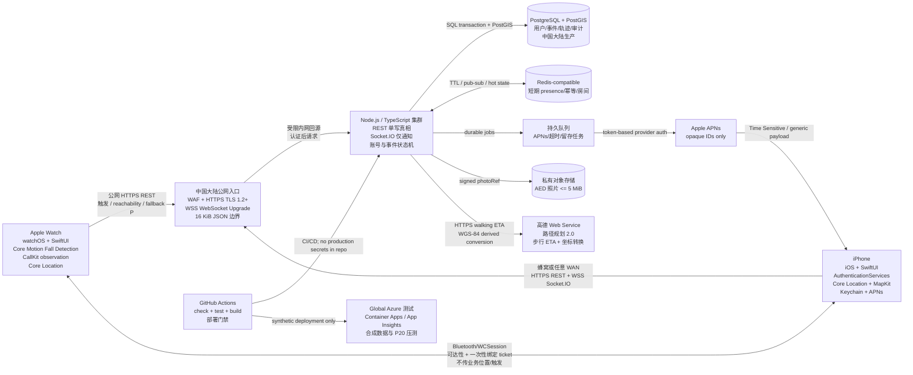
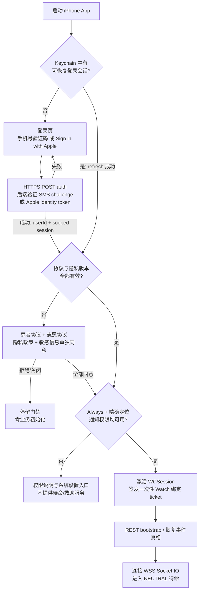
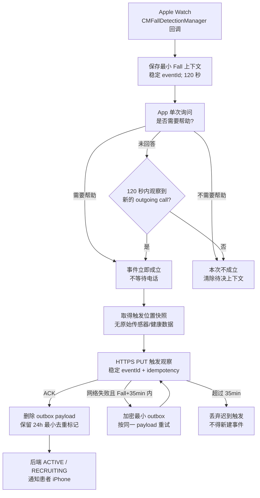
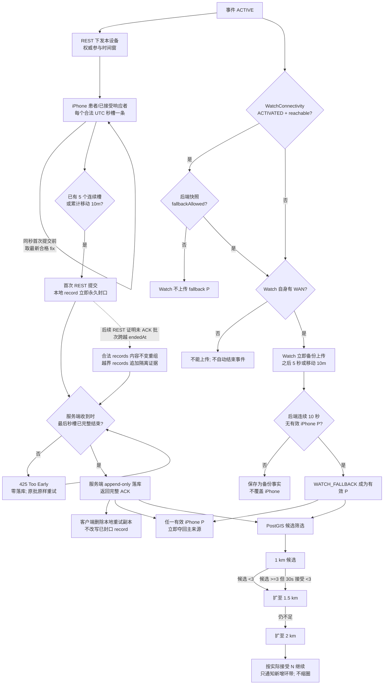
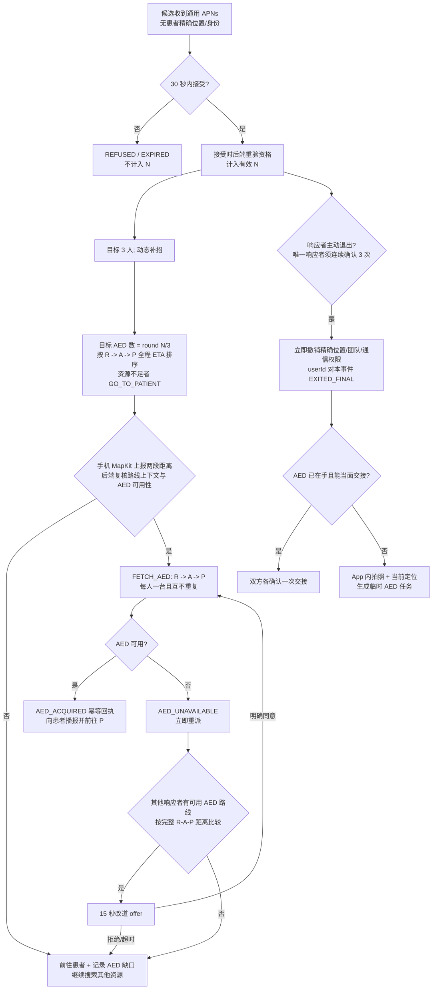
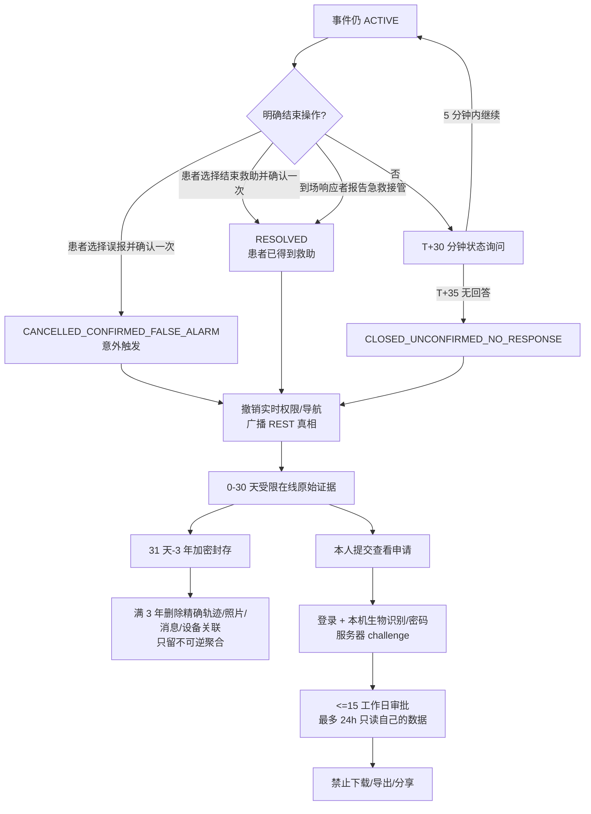

# AEDResponse v2 实际运行流程与技术架构

状态：2026-09-05 已确认。本文只描述最终目标架构；当前实现进度与外部门槛见 `HANDOFF.md`。

## 1. 生产部署与信任边界

生产真实数据只进入中国大陆部署。Windows 是本地开发、真机联调和压测控制端；Tailscale 只用于管理员 SSH，不在上图业务链路中。

## 2. App 启动、登录、协议和权限

未通过任一门禁时，不得定位、不连接业务后端、不启动 Watch 业务监控。生产 App 没有游客、密码、邮箱或其他登录。

## 3. Fall 检测与事件成立

CallKit 只提供“观察到一个新的外拨”，不能提供号码，因而不能证明拨打 120；App 也不能检测系统给紧急联系人的短信。

## 4. P/R 定位、Watch 降级与动态扩圈

非事件普通待命 R 为 120 秒/100 米；进入搜索圈而未接受为 15 秒/30 米。两者只保留最新位置，服务端 10 分钟 TTL 删除。事件参与者在自身权威参与窗口内对每个合法 UTC 整秒槽恰好留一条：有新定位则为 `FIX`，没有则为 `NO_NEW_FIX/NO_FIX`，进程未运行且重启等待 5 秒后仍缺失则为 `NO_NEW_FIX/APP_NOT_RUNNING`。不复制旧坐标。首次提交后只可原样重试；ACK 只解锁本地重试副本的删除。

## 5. 响应、AED 调度与退出

## 6. 结束、留存和查看申请

事件证据按序号和 SHA-256 hash chain 追加，媒体和位置批次各有 hash，终态生成服务器签名 manifest。该结构证明记录完整性，不证明现实内容必然真实。
